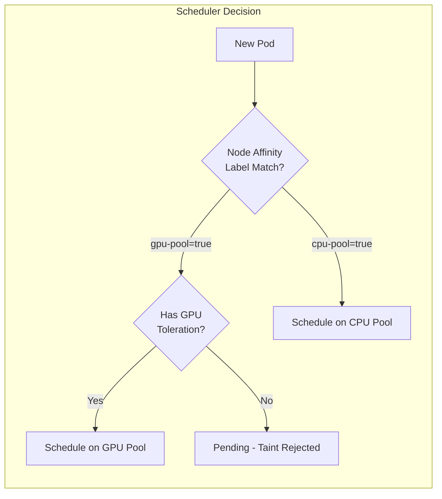
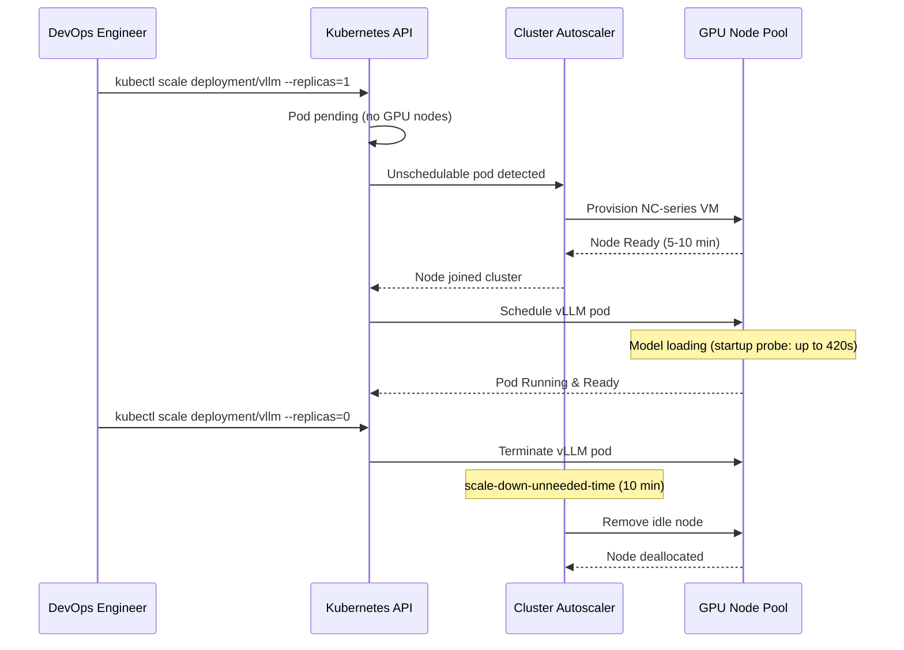
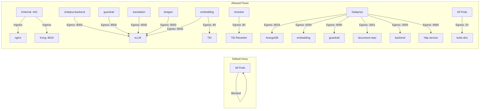

# Design Document: Infrastructure Split (AKS)

## Overview

This design deploys the GenieAI MVP application on a single Azure Kubernetes Service (AKS) cluster with workload separation between GPU-dependent and CPU-only services using dedicated node pools. The architecture replaces the previous Docker Compose on separate VMs approach with Kubernetes-native scheduling, networking, and lifecycle management.

**Key architectural decisions:**

- **Single AKS cluster, dual node pools**: A GPU node pool (NC-series VMs with NVIDIA T4) and a CPU node pool (Standard VMs) within the same cluster provides cost isolation while keeping all services under one control plane.
- **Node affinity + taints/tolerations** for workload pinning instead of physical VM separation.
- **Kubernetes internal DNS** for all service discovery — no hardcoded IPs or cross-tier host variables.
- **NetworkPolicies** for microsegmentation — replaces Azure NSGs between VMs.
- **Cluster Autoscaler with GPU scale-to-zero** — GPU nodes are deprovisioned when no inference pods are running.
- **Helm chart** for templating — environment-specific values files replace shell scripts for configuration management.
- **nginx Ingress Controller** for TLS termination and external traffic routing.

### Design Rationale

| Decision | Rationale |
|----------|-----------|
| Single cluster over multiple | Simplifies networking, RBAC, and observability; DNS works out of the box |
| Node pools over namespaces | Hardware isolation (GPU vs CPU) requires node-level separation |
| Helm over Kustomize | Team familiarity; native rollback; values files per environment |
| NetworkPolicy over Calico/Cilium | AKS Azure CNI supports native NetworkPolicy; no additional CNI add-on required |
| Azure Disk over Azure File for databases | Block storage gives predictable IOPS for ArangoDB, PostgreSQL |
| Azure File for shared storage | ReadWriteMany needed for document-repository uploads |
| Scale-to-zero GPU pool | NC-series VMs cost ~$1.50/hr; eliminating idle GPU time saves significant cost |

## Architecture

### Cluster Topology

```mermaid
graph TB
    subgraph Internet
        Users[Users / Clients]
    end

    subgraph AKS Cluster
        subgraph Ingress Layer
            IC[nginx Ingress Controller<br/>TLS termination :443]
        end

        subgraph CPU Node Pool - Standard VMs
            subgraph Public Services
                NGINX[nginx Pod :80]
                Kong[Kong Pod :8010]
            end

            subgraph Application
                Frontend[frontend :5173]
                Backend[backend :3000]
                DocRepo[document-repository :3001]
                ChatQnA[chatqna-xeon-backend :8888]
                ChatQnAUI[chatqna-xeon-ui :5173]
                ChatQnANginx[chatqna-xeon-nginx :80]
            end

            subgraph Data
                ArangoDB[ArangoDB :8529]
                Redis[redis-cache :6379]
                KongDB[kong-database :5432]
                KeycloakDB[keycloak-db :5432]
            end

            subgraph Auth
                Keycloak[Keycloak :8080]
                ClamAV[ClamAV :3310]
            end

            subgraph CPU Microservices
                Embedding[embedding :6000]
                Reranker[reranker :6100]
                Retriever[retriever-arango :7025]
                TextGen[textgen :9000]
                Translation[translation :9030]
                Guardrail[guardrail :9090]
                HttpService[http-service :6666]
            end

            subgraph Monitoring
                HealthMon[health-monitor :8080]
            end
        end

        subgraph GPU Node Pool - NC-series VMs with T4
            NVIDIA[NVIDIA Device Plugin DaemonSet]
            vLLM[vLLM :8000]
            TEI[TEI Embedding :80]
            TEI_R[TEI Reranker :80]
            Dataprep[Dataprep/Docling :5000]
        end
    end

    Users -->|HTTPS :443| IC
    IC --> NGINX
    IC --> Kong
    NGINX --> Kong
    Kong --> Backend
    Kong --> DocRepo

    %% CPU to GPU via K8s DNS
    Embedding -->|vllm:8000| vLLM
    Reranker -->|tei-reranker:80| TEI_R
    TextGen -->|vllm:8000| vLLM
    Translation -->|vllm:8000| vLLM
    Guardrail -->|vllm:8000| vLLM
    ChatQnA -->|vllm:8000| vLLM
    Embedding -->|tei:80| TEI

    %% GPU to CPU via K8s DNS
    Dataprep -->|arango-vector-db:8529| ArangoDB
    Dataprep -->|embedding:6000| Embedding
    Dataprep -->|guardrail:9090| Guardrail
    Dataprep -->|document-repository:3001| DocRepo
    Dataprep -->|backend:3000| Backend
    Dataprep -->|http-service:6666| HttpService
```



### Node Pool Scheduling



### Autoscaler Behavior



### NetworkPolicy Flow



## Components and Interfaces

### 1. NVIDIA Device Plugin DaemonSet

Runs on all GPU node pool nodes. Advertises `nvidia.com/gpu` resources to the Kubernetes scheduler.

```yaml
apiVersion: apps/v1
kind: DaemonSet
metadata:
  name: nvidia-device-plugin
  namespace: kube-system
spec:
  selector:
    matchLabels:
      name: nvidia-device-plugin
  template:
    spec:
      tolerations:
        - key: "nvidia.com/gpu"
          operator: "Exists"
          effect: "NoSchedule"
      nodeSelector:
        gpu-pool: "true"
      containers:
        - name: nvidia-device-plugin
          image: nvcr.io/nvidia/k8s-device-plugin:v0.14.5
          securityContext:
            privileged: true
```

### 2. GPU Service Deployments

Each GPU service (vLLM, TEI, TEI Reranker, Dataprep) is a Kubernetes Deployment with:
- `requiredDuringSchedulingIgnoredDuringExecution` node affinity for `gpu-pool=true`
- Toleration for taint `nvidia.com/gpu=present:NoSchedule`
- Resource requests/limits: `nvidia.com/gpu: 1`
- Startup probe with generous timeout (420s) for model loading
- Readiness/liveness probes on health endpoints

### 3. CPU Service Deployments

All 21 CPU-only services are Kubernetes Deployments with:
- `requiredDuringSchedulingIgnoredDuringExecution` node affinity for `cpu-pool=true`
- No GPU resource requests or tolerations
- Readiness/liveness probes appropriate to service type (HTTP, TCP, or exec)
- Startup probes for slow-starting services (databases, Keycloak)

### 4. Kubernetes Services (ClusterIP)

Every Deployment has a matching ClusterIP Service enabling DNS-based discovery:

| Service Name | Target Port | Discovery Address |
|-------------|-------------|-------------------|
| vllm | 8000 | vllm.genieai.svc.cluster.local:8000 |
| tei | 80 | tei.genieai.svc.cluster.local:80 |
| tei-reranker | 80 | tei-reranker.genieai.svc.cluster.local:80 |
| dataprep | 5000 | dataprep.genieai.svc.cluster.local:5000 |
| arango-vector-db | 8529 | arango-vector-db.genieai.svc.cluster.local:8529 |
| kong | 8010 | kong.genieai.svc.cluster.local:8010 |
| keycloak | 8080 | keycloak.genieai.svc.cluster.local:8080 |
| backend | 3000 | backend.genieai.svc.cluster.local:3000 |
| frontend | 5173 | frontend.genieai.svc.cluster.local:5173 |
| document-repository | 3001 | document-repository.genieai.svc.cluster.local:3001 |
| embedding | 6000 | embedding.genieai.svc.cluster.local:6000 |
| reranker | 6100 | reranker.genieai.svc.cluster.local:6100 |
| guardrail | 9090 | guardrail.genieai.svc.cluster.local:9090 |
| textgen | 9000 | textgen.genieai.svc.cluster.local:9000 |
| translation | 9030 | translation.genieai.svc.cluster.local:9030 |
| http-service | 6666 | http-service.genieai.svc.cluster.local:6666 |
| redis-cache | 6379 | redis-cache.genieai.svc.cluster.local:6379 |
| kong-database | 5432 | kong-database.genieai.svc.cluster.local:5432 |
| keycloak-db | 5432 | keycloak-db.genieai.svc.cluster.local:5432 |
| nginx | 80 | nginx.genieai.svc.cluster.local:80 |
| clamav | 3310 | clamav.genieai.svc.cluster.local:3310 |
| retriever-arango-service | 7025 | retriever-arango-service.genieai.svc.cluster.local:7025 |
| chatqna-xeon-backend-server | 8888 | chatqna-xeon-backend-server.genieai.svc.cluster.local:8888 |
| chatqna-xeon-ui-server | 5173 | chatqna-xeon-ui-server.genieai.svc.cluster.local:5173 |
| chatqna-xeon-nginx-server | 80 | chatqna-xeon-nginx-server.genieai.svc.cluster.local:80 |
| health-monitor | 8080 | health-monitor.genieai.svc.cluster.local:8080 |

### 5. NetworkPolicy Resources

A set of NetworkPolicy manifests implementing default-deny plus explicit allow rules:

| Policy Name | Purpose |
|------------|---------|
| `default-deny-all` | Block all ingress/egress in the namespace |
| `allow-dns-egress` | Allow all pods to reach kube-dns on port 53 |
| `allow-external-ingress` | Allow external traffic to nginx (:80,:443) and Kong (:8010) |
| `allow-cpu-to-gpu-egress` | Allow CPU services to reach GPU services on their ports |
| `allow-gpu-to-cpu-egress` | Allow Dataprep to reach CPU services on their ports |
| `allow-gpu-ingress-from-cpu` | Allow GPU pods to receive from authorized CPU pods |
| `allow-cpu-ingress-from-gpu` | Allow CPU pods to receive from Dataprep |
| `allow-internal-cpu` | Allow internal CPU-to-CPU communication paths |

### 6. PersistentVolumeClaims

| PVC Name | StorageClass | Access Mode | Capacity | Mounted By |
|----------|-------------|-------------|----------|------------|
| arango-data-pvc | managed-premium | ReadWriteOnce | 50Gi | ArangoDB |
| kong-db-pvc | managed-premium | ReadWriteOnce | 10Gi | kong-database |
| keycloak-db-pvc | managed-premium | ReadWriteOnce | 10Gi | keycloak-db |
| document-uploads-pvc | azurefile | ReadWriteMany | 50Gi | document-repository |
| redis-data-pvc | azurefile | ReadWriteMany | 10Gi | redis-cache |

### 7. nginx Ingress Controller

Deployed as a LoadBalancer-type Service with:
- TLS termination using certificate from Kubernetes Secret (`tls-secret`)
- HTTP→HTTPS redirect (301)
- Host/path-based routing to nginx and Kong services
- Default backend returning 404 for unmatched routes

### 8. Helm Chart Structure

```
helm/genieai/
├── Chart.yaml
├── values.yaml                    # Default values
├── values-dev.yaml                # Development overrides
├── values-staging.yaml            # Staging overrides
├── values-prod.yaml               # Production overrides
├── templates/
│   ├── _helpers.tpl               # Template helpers
│   ├── namespace.yaml
│   ├── NOTES.txt
│   │
│   ├── # GPU Services
│   ├── gpu/
│   │   ├── vllm-deployment.yaml
│   │   ├── vllm-service.yaml
│   │   ├── tei-deployment.yaml
│   │   ├── tei-service.yaml
│   │   ├── tei-reranker-deployment.yaml
│   │   ├── tei-reranker-service.yaml
│   │   ├── dataprep-deployment.yaml
│   │   └── dataprep-service.yaml
│   │
│   ├── # CPU Services
│   ├── cpu/
│   │   ├── backend-deployment.yaml
│   │   ├── backend-service.yaml
│   │   ├── frontend-deployment.yaml
│   │   ├── frontend-service.yaml
│   │   ├── ... (all 21 CPU services)
│   │   ├── health-monitor-deployment.yaml
│   │   └── health-monitor-service.yaml
│   │
│   ├── # Networking
│   ├── networking/
│   │   ├── ingress.yaml
│   │   ├── networkpolicy-default-deny.yaml
│   │   ├── networkpolicy-dns.yaml
│   │   ├── networkpolicy-external.yaml
│   │   ├── networkpolicy-cpu-to-gpu.yaml
│   │   ├── networkpolicy-gpu-to-cpu.yaml
│   │   └── networkpolicy-internal-cpu.yaml
│   │
│   ├── # Storage
│   ├── storage/
│   │   ├── arango-pvc.yaml
│   │   ├── kong-db-pvc.yaml
│   │   ├── keycloak-db-pvc.yaml
│   │   ├── document-uploads-pvc.yaml
│   │   └── redis-data-pvc.yaml
│   │
│   ├── # Config
│   ├── config/
│   │   ├── configmap-gpu-services.yaml
│   │   ├── configmap-cpu-services.yaml
│   │   └── secrets.yaml
│   │
│   └── # Autoscaling
│       └── cluster-autoscaler-config.yaml
│
└── tests/
    ├── test-connectivity.yaml     # Helm test pod
    └── test-health.yaml           # Helm test pod
```

### 9. Health Monitor Deployment

A Kubernetes Deployment on the CPU node pool that:
- Polls GPU service endpoints (`/health`) every 10 seconds
- Polls CPU service endpoints every 10 seconds (TCP or HTTP)
- Exposes `/health-status` returning JSON with per-service status
- Distinguishes "scaled-down" from "unhealthy" by checking Kubernetes Endpoints API
- Transitions: healthy → degraded (3 consecutive failures) → unreachable (6 consecutive failures)
- Recovery: degraded/unreachable → healthy (2 consecutive successes)

### 10. Cluster Autoscaler Configuration

- **GPU Node Pool**: min=0, max=2 (configurable), scale-down-unneeded-time=10m
- **CPU Node Pool**: min=1, max configurable, maintains baseline availability

## Data Models

### ConfigMap Schema — GPU Services

```yaml
apiVersion: v1
kind: ConfigMap
metadata:
  name: gpu-services-config
  namespace: genieai
data:
  # vLLM configuration
  VLLM_MODEL: "meta-llama/Llama-3.1-8B-Instruct"
  VLLM_PORT: "8000"
  VLLM_MAX_MODEL_LEN: "8192"
  VLLM_GPU_MEMORY_UTILIZATION: "0.9"
  VLLM_DTYPE: "float16"
  VLLM_TRUST_REMOTE_CODE: "true"
  
  # TEI Embedding configuration
  TEI_MODEL: "BAAI/bge-base-en-v1.5"
  TEI_PORT: "80"
  TEI_MAX_BATCH_REQUESTS: "64"
  
  # TEI Reranker configuration
  TEI_RERANKER_MODEL: "BAAI/bge-reranker-base"
  TEI_RERANKER_PORT: "80"
  
  # Dataprep configuration
  DATAPREP_PORT: "5000"
  ARANGO_URL: "http://arango-vector-db.genieai.svc.cluster.local:8529"
  EMBEDDING_ENDPOINT: "http://embedding.genieai.svc.cluster.local:6000"
  GUARDRAIL_URL: "http://guardrail.genieai.svc.cluster.local:9090"
  DOCUMENT_REPOSITORY_URL: "http://document-repository.genieai.svc.cluster.local:3001"
  BACKEND_SERVICE_URL: "http://backend.genieai.svc.cluster.local:3000"
  HTTP_SERVICE_URL: "http://http-service.genieai.svc.cluster.local:6666"
```

### ConfigMap Schema — CPU Services

```yaml
apiVersion: v1
kind: ConfigMap
metadata:
  name: cpu-services-config
  namespace: genieai
data:
  # Service endpoint references (Kubernetes DNS)
  VLLM_ENDPOINT: "http://vllm.genieai.svc.cluster.local:8000"
  TEI_EMBEDDING_ENDPOINT: "http://tei.genieai.svc.cluster.local:80"
  TEI_RERANKING_ENDPOINT: "http://tei-reranker.genieai.svc.cluster.local:80"
  
  # Internal CPU service references
  ARANGO_URL: "http://arango-vector-db.genieai.svc.cluster.local:8529"
  REDIS_HOST: "redis-cache.genieai.svc.cluster.local"
  REDIS_PORT: "6379"
  KEYCLOAK_URL: "http://keycloak.genieai.svc.cluster.local:8080/auth"
  BACKEND_URL: "http://backend.genieai.svc.cluster.local:3000"
  
  # Application settings
  NODE_ENV: "production"
  LOG_LEVEL: "info"
```

### Secrets Schema

```yaml
apiVersion: v1
kind: Secret
metadata:
  name: genieai-secrets
  namespace: genieai
type: Opaque
# Values sourced from Azure Key Vault via Secrets Store CSI Driver
data:
  ARANGO_ROOT_PASSWORD: ""       # ArangoDB root password
  KONG_PG_PASSWORD: ""           # Kong PostgreSQL password
  KEYCLOAK_DB_PASSWORD: ""       # Keycloak PostgreSQL password
  KEYCLOAK_ADMIN_PASSWORD: ""    # Keycloak admin console password
  HF_TOKEN: ""                   # HuggingFace API token for model downloads
  JWT_SECRET: ""                 # JWT signing secret
  ENCRYPTION_KEY: ""             # Application encryption key
```

### Health Status Model

```typescript
interface HealthStatusResponse {
  timestamp: string;                    // ISO 8601
  clusterStatus: "healthy" | "degraded" | "partially-scaled-down" | "unhealthy";
  gpuNodePoolActive: boolean;           // true if GPU node count > 0
  services: ServiceHealthEntry[];
}

interface ServiceHealthEntry {
  name: string;                         // Kubernetes Service name
  nodePool: "gpu" | "cpu";
  status: "healthy" | "degraded" | "scaled-down" | "unreachable";
  lastChecked: string;                  // ISO 8601
  consecutiveFailures: number;
  consecutiveSuccesses: number;
  endpoint: string;                     // e.g., "http://vllm:8000/health"
  responseTimeMs: number | null;
  hasEndpoints: boolean;                // false when scaled to 0
}

// State machine transitions:
// healthy → degraded: 3 consecutive failures
// degraded → unreachable: 3 more consecutive failures (6 total)
// degraded/unreachable → healthy: 2 consecutive successes
// healthy → scaled-down: service endpoints empty AND gpu node pool count = 0
// scaled-down → healthy: endpoints available AND health check passes
```

### NetworkPolicy Rules Matrix

| Source | Destination | Port | Protocol | Direction |
|--------|------------|------|----------|-----------|
| * (all pods) | kube-dns (kube-system) | 53 | UDP/TCP | Egress |
| external (0.0.0.0/0) | nginx | 80, 443 | TCP | Ingress |
| external (0.0.0.0/0) | kong | 8010 | TCP | Ingress |
| embedding | vllm | 8000 | TCP | Egress/Ingress |
| embedding | tei | 80 | TCP | Egress/Ingress |
| reranker | tei-reranker | 80 | TCP | Egress/Ingress |
| textgen | vllm | 8000 | TCP | Egress/Ingress |
| translation | vllm | 8000 | TCP | Egress/Ingress |
| guardrail | vllm | 8000 | TCP | Egress/Ingress |
| chatqna-xeon-backend-server | vllm | 8000 | TCP | Egress/Ingress |
| dataprep | arango-vector-db | 8529 | TCP | Egress/Ingress |
| dataprep | embedding | 6000 | TCP | Egress/Ingress |
| dataprep | guardrail | 9090 | TCP | Egress/Ingress |
| dataprep | document-repository | 3001 | TCP | Egress/Ingress |
| dataprep | backend | 3000 | TCP | Egress/Ingress |
| dataprep | http-service | 6666 | TCP | Egress/Ingress |


## Correctness Properties

*A property is a characteristic or behavior that should hold true across all valid executions of a system — essentially, a formal statement about what the system should do. Properties serve as the bridge between human-readable specifications and machine-verifiable correctness guarantees.*

This feature involves both infrastructure configuration and pure logic components (manifest generation, NetworkPolicy generation, health monitor state machine, deployment state machine). The properties below target the logic components suitable for property-based testing.

### Property 1: GPU Manifest Scheduling Correctness

*For any* GPU service definition (vLLM, TEI, TEI Reranker, or Dataprep) with any valid container image, port, and environment configuration, the generated Kubernetes Deployment manifest SHALL contain: (a) a `requiredDuringSchedulingIgnoredDuringExecution` node affinity rule matching `gpu-pool=true`, (b) a toleration for taint key `nvidia.com/gpu` with value `present` and effect `NoSchedule`, and (c) a resource request and limit of `nvidia.com/gpu: 1`.

**Validates: Requirements 1.2, 1.3**

### Property 2: CPU Manifest Scheduling Correctness

*For any* CPU-only service definition with any valid container image, port, and environment configuration, the generated Kubernetes Deployment manifest SHALL contain: (a) a `requiredDuringSchedulingIgnoredDuringExecution` node affinity rule matching the CPU node pool label, (b) NO `nvidia.com/gpu` resource requests or limits, and (c) NO tolerations for the GPU node pool taint.

**Validates: Requirements 2.1, 2.2, 2.3**

### Property 3: Service Resource Generation

*For any* set of workload definitions (GPU or CPU), the manifest generator SHALL produce: (a) exactly one ClusterIP Service per Deployment with the Service name matching the Deployment name, (b) all resources in a single namespace, (c) each Service's `targetPort` equal to the container's declared `containerPort`, and (d) Service type `ClusterIP` for all non-ingress services.

**Validates: Requirements 3.1, 3.4, 3.5, 9.4**

### Property 4: Endpoint DNS Format

*For any* service dependency where a CPU service references a GPU service, or the Dataprep service references a CPU service, the generated environment variable value SHALL be a valid URL of the form `http://<service-name>.<namespace>.svc.cluster.local:<port>` where `<service-name>` matches the target Kubernetes Service name and `<port>` matches the target service's container port.

**Validates: Requirements 3.2, 3.3**

### Property 5: NetworkPolicy Baseline Generation

*For any* valid namespace configuration, the generated NetworkPolicy set SHALL always include: (a) a default-deny policy selecting all pods with both Ingress and Egress policyTypes and no allow rules, and (b) a DNS egress policy allowing all pods to reach port 53 (UDP and TCP) on pods matching the kube-dns label in kube-system namespace.

**Validates: Requirements 4.1, 4.6**

### Property 6: NetworkPolicy Allow Rules Match Dependency Graph

*For any* valid service dependency graph specifying which services may communicate and on which ports, the generated NetworkPolicy set SHALL: (a) contain ingress rules for GPU services allowing traffic ONLY from the specified CPU source pods on the specified GPU service ports, (b) contain ingress rules for CPU services (from Dataprep) allowing traffic ONLY from the Dataprep pod on the specified CPU service ports, (c) contain external ingress rules ONLY for nginx (ports 80, 443) and Kong (port 8010), and (d) contain matching egress rules for each authorized communication path. No policy SHALL allow traffic between pods not connected in the dependency graph.

**Validates: Requirements 4.2, 4.3, 4.4, 4.7**

### Property 7: PVC Configuration Correctness

*For any* stateful service definition specifying storage type (block or shared) and required capacity, the generated PVC SHALL use: (a) `managed-premium` StorageClass with `ReadWriteOnce` access mode for block storage services (databases), or (b) `azurefile` StorageClass with `ReadWriteMany` access mode for shared storage services, with capacity set to at least the declared usage plus 50% headroom (minimum 10 GiB for Azure File).

**Validates: Requirements 5.1, 5.2, 5.6**

### Property 8: Volume Mount Path Preservation

*For any* stateful service definition that specifies an original Docker volume mount path, the generated Kubernetes Deployment manifest SHALL mount the corresponding PVC at exactly the same filesystem path, preserving application compatibility.

**Validates: Requirements 5.3**

### Property 9: Health Probe Generation

*For any* service definition specifying probe type (HTTP, TCP, or exec) and endpoint information, the generated Deployment manifest SHALL contain: (a) a readiness probe with `periodSeconds=10`, `timeoutSeconds=5`, `successThreshold=1`, (b) a liveness probe with `failureThreshold=3`, `periodSeconds=10`, `timeoutSeconds=5`, (c) for GPU services: a startup probe with `initialDelaySeconds=60`, `periodSeconds=12`, `failureThreshold=30`, and (d) for slow-starting CPU services: a startup probe with `initialDelaySeconds=10`, `periodSeconds=5`, `failureThreshold=30`.

**Validates: Requirements 6.1, 6.2, 6.3, 6.6**

### Property 10: Rolling Update Strategy

*For any* generated Deployment manifest (GPU or CPU), the `strategy` field SHALL specify `type: RollingUpdate` with `maxUnavailable: 0` and `maxSurge: 1`, ensuring zero-downtime updates.

**Validates: Requirements 8.3**

### Property 11: Helm Template Parameterization and Secrets Separation

*For any* set of environment-specific values (resource limits, replica counts, endpoints, credentials), the Helm chart template output SHALL: (a) produce different manifest content when different values files are applied (parameterization works), and (b) place all values marked as sensitive (passwords, tokens, API keys) into Kubernetes Secret resources rather than ConfigMaps or environment variable literals.

**Validates: Requirements 8.1, 8.2**

### Property 12: Dry-Run Validation Detects Invalid Manifests

*For any* generated manifest set, if a manifest contains a schema violation (missing required field, invalid field type, reference to undefined resource), the dry-run validation function SHALL reject the manifest set and produce an error message identifying the invalid resource and reason. Conversely, for any valid manifest set, the dry-run validation SHALL accept it without errors.

**Validates: Requirements 8.7**

### Property 13: Deployment Rollback State Machine

*For any* deployment timeline where a Deployment fails to reach desired ready replicas: (a) if unready for exactly 300 seconds, rollback SHALL be triggered, (b) if rollback succeeds (previous revision healthy within 120s), the system SHALL report success, and (c) if rollback fails to restore health within 120 seconds, the system SHALL preserve current state, report failure with Deployment name and error details, and exit non-zero.

**Validates: Requirements 8.5, 8.8**

### Property 14: Health Monitor State Machine

*For any* sequence of health check results (success/failure) for a service endpoint: (a) the service status SHALL transition from "healthy" to "degraded" if and only if 3 consecutive failures occur, (b) from "degraded" to "unreachable" if and only if 3 more consecutive failures occur (6 total), (c) from "degraded" or "unreachable" back to "healthy" if and only if 2 consecutive successes occur, and (d) status SHALL be "scaled-down" if and only if the service has no Kubernetes endpoints AND the GPU node pool count is 0. A single success between failures SHALL reset the consecutive failure count to zero.

**Validates: Requirements 10.2, 10.4, 10.6**

### Property 15: Health Status JSON Completeness

*For any* internal health state of the monitoring component (with any combination of service statuses), the `/health-status` JSON response SHALL contain: (a) a top-level `timestamp` (valid ISO 8601), `clusterStatus`, `gpuNodePoolActive` boolean, and `services` array, (b) one entry per monitored service with all required fields (`name`, `nodePool`, `status`, `lastChecked`, `consecutiveFailures`, `consecutiveSuccesses`, `endpoint`, `responseTimeMs`, `hasEndpoints`), and (c) response delivered within 5 seconds.

**Validates: Requirements 10.5**

## Error Handling

### Pod Scheduling Failures

| Scenario | Detection | Response |
|----------|-----------|----------|
| GPU pod pending — no GPU nodes available | Pod in Pending state, Cluster Autoscaler event | Autoscaler provisions new NC-series node; health monitor reports "scaled-down" |
| GPU pod pending > 15 minutes | Deployment timeout check | Report scaling failure event with pod name and pending reason |
| CPU pod pending — insufficient resources | Pod in Pending state with FailedScheduling event | Autoscaler scales CPU pool; event logged |
| Pod rejected by taint | Pod has no matching toleration | Pod stays Pending with taint rejection event |

### Service Communication Failures

| Scenario | Detection | Response |
|----------|-----------|----------|
| GPU service unreachable (scaled-down) | No endpoints for Service; GPU node count = 0 | Health monitor reports "scaled-down"; CPU services receive connection-refused |
| GPU service unhealthy (running but failing) | Readiness probe fails; pod removed from endpoints | Health monitor reports "degraded" after 3 failures; traffic stops routing to pod |
| DNS resolution failure | Connection error within 5 seconds | Calling service logs unresolved service name and namespace |
| NetworkPolicy blocks communication | Connection timeout/reset | No traffic flows; debug via `kubectl describe networkpolicy` |

### Storage Failures

| Scenario | Detection | Response |
|----------|-----------|----------|
| PVC cannot bind | PVC in Pending state > 120s | Kubernetes Event on PVC with binding failure reason |
| Azure Disk unavailable after node reschedule | Pod fails to start, volume mount error | Pod stays in ContainerCreating; event logged |
| Azure File share unreachable | I/O errors in pod logs | Pod continues running but operations fail; liveness probe may fail |

### Deployment Failures

| Scenario | Detection | Response |
|----------|-----------|----------|
| Deployment not ready within 300s | Helm --wait timeout or monitoring check | Automatic rollback to previous revision |
| Rollback fails within 120s | Post-rollback health check | Preserve cluster state; report failure; exit non-zero |
| Dry-run validation fails | helm template --validate or kubectl apply --dry-run=server | Abort deployment; descriptive error message; exit non-zero |
| Rolling update pod crash loop | New pod CrashLoopBackOff during rollout | maxUnavailable=0 prevents service disruption; rollback triggered at 300s |

### Ingress Failures

| Scenario | Detection | Response |
|----------|-----------|----------|
| TLS Secret missing/invalid | Ingress Controller error event | HTTPS not served on affected host; Event logged on Ingress resource |
| Unmatched host/path | Request doesn't match any IngressRule | 404 response from default backend |
| Backend service unavailable | No ready endpoints for routed Service | 502/503 from Ingress Controller |

### Retry Strategy

Services calling GPU endpoints (when GPU is available but under load):
- **Connection timeout**: 5 seconds
- **Request timeout**: 120 seconds (inference can be slow)
- **Readiness gating**: Kubernetes only routes traffic to Ready pods — no application-level retry needed for unavailable pods
- **Circuit breaking**: Handled by Kubernetes endpoint removal (readiness probe failure removes pod from Service endpoints)

## Testing Strategy

### Test Categories

**1. Configuration Validation Tests (Smoke/Schema)**

Validate infrastructure state after deployment:
- GPU node pool has NC-series VMs with NVIDIA T4
- GPU node pool has correct taint applied
- NVIDIA Device Plugin DaemonSet is running and Ready
- CPU node pool uses Standard VM SKUs
- Cluster Autoscaler enabled on both pools with correct min/max
- Ingress Controller deployed and serving HTTPS
- TLS 1.2 minimum enforced

**Tool**: Azure CLI (`az aks show`, `kubectl get nodes`) + pytest assertions.

**2. Property-Based Tests**

Testing pure logic components with randomized inputs. Minimum 100 iterations per property.

| Property | Component Under Test | Generator Strategy |
|----------|---------------------|-------------------|
| 1: GPU Manifest Scheduling | Manifest generator | Random GPU service configs (image, ports, env vars, model names) |
| 2: CPU Manifest Scheduling | Manifest generator | Random CPU service configs (image, ports, env vars) |
| 3: Service Resource Generation | Manifest generator | Random workload sets with varying ports and names |
| 4: Endpoint DNS Format | Env var generator | Random service dependency graphs with valid service names and ports |
| 5: NetworkPolicy Baseline | Policy generator | Random namespace configurations |
| 6: NetworkPolicy Allow Rules | Policy generator | Random dependency graphs with varying edge sets |
| 7: PVC Configuration | Storage generator | Random storage requirements (type, capacity, service name) |
| 8: Volume Mount Paths | Storage generator | Random mount path strings and PVC names |
| 9: Health Probe Generation | Probe generator | Random service definitions (HTTP/TCP/exec, GPU/CPU, slow/fast start) |
| 10: Rolling Update Strategy | Manifest generator | Random Deployment specs |
| 11: Helm Parameterization | Helm template engine | Random values files with sensitive/non-sensitive fields |
| 12: Dry-Run Validation | Validation function | Random manifests (valid and invalid) |
| 13: Deployment Rollback | Deployment state machine | Random timelines of ready/unready states |
| 14: Health Monitor State Machine | Health monitor logic | Random sequences of pass/fail health checks + node pool states |
| 15: Health Status JSON | Status serializer | Random internal health states |

**Tool**: Hypothesis (Python) or fast-check (TypeScript/JavaScript).
**Tag format**: `Feature: infrastructure-split, Property {N}: {property_text}`

**3. Integration Tests**

Verify end-to-end behavior in a real AKS cluster:
- GPU pod scheduled on GPU node pool (verify node labels)
- CPU pod scheduled on CPU node pool (verify node labels)
- Cross-pool DNS resolution (CPU pod resolves GPU service name)
- GPU service returns connection-refused when scaled to 0
- NetworkPolicy blocks unauthorized pod-to-pod traffic
- NetworkPolicy allows authorized communication paths
- PVC data persists across pod rescheduling
- Autoscaler provisions GPU node when GPU pod is created
- Autoscaler removes GPU node after scale-down delay
- Ingress terminates TLS and routes to backend services
- HTTP→HTTPS redirect works
- Deployment rollback triggered on unhealthy rollout

**Tool**: pytest + kubectl + Azure CLI, run against a staging AKS cluster.

**4. Unit Tests (Example-Based)**

Specific scenarios not suited to property testing:
- Health monitor correctly identifies "scaled-down" vs "unhealthy" for a known scenario
- Helm chart renders correctly for dev/staging/prod values files
- GPU Deployment can be scaled to 0 replicas
- Ingress returns 404 for unmatched route (manual curl test)
- Default-deny policy blocks a new unlabeled pod
- Correct services are listed in health-status response

**5. Helm Chart Tests**

Using `helm unittest` plugin:
- All templates render without errors for each values file
- GPU deployments have nvidia.com/gpu resources
- CPU deployments do not have GPU resources
- All Services are ClusterIP type (except Ingress Controller)
- NetworkPolicy default-deny is always rendered
- PVC StorageClass matches expected values per environment
- Secrets are not rendered with literal values (use external references)

### Test Infrastructure

- **Local**: `helm template` + schema validation + property tests (no cluster needed)
- **CI Pipeline**: Lint (`helm lint`), template validation, property tests, Helm unit tests
- **Staging**: Full AKS cluster deployment with integration test suite
- **Cost control**: GPU integration tests run only on manual trigger or release branch (GPU VMs are expensive)
