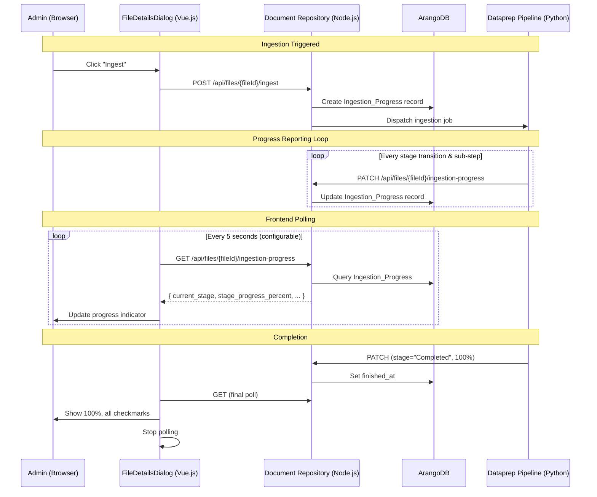

# Design Document: Ingestion Progress Feedback

## Overview

This feature adds real-time ingestion progress tracking and display across three system components:

1. **Document Repository (Node.js backend)**: Stores and serves `Ingestion_Progress` records via a new REST endpoint, receives progress updates from the Dataprep Pipeline via HTTP PATCH.
2. **Dataprep Pipeline (Python)**: Reports stage transitions and sub-step progress to the Document Repository during each pipeline stage (Extraction → Chunking → Guardrail → Labeling → Graph).
3. **Frontend (Vue.js)**: Polls the progress endpoint, displays a multi-stage progress indicator with per-stage icons and an overall progress bar, and auto-refreshes the ingestion log tab.

The design follows the existing communication pattern where the Dataprep Pipeline calls back to the Document Repository via authenticated HTTP, and the frontend polls the Document Repository for state. No WebSocket or SSE connections are introduced to keep infrastructure simple.

## Architecture



### Design Decisions

1. **Polling over WebSockets**: The existing crawl dashboard already uses polling (5-second intervals). This avoids new infrastructure dependencies and matches the established pattern.
2. **Separate collection for progress**: Storing `Ingestion_Progress` in its own ArangoDB collection (vs. embedding in the file document) avoids frequent writes to the main `files` document and allows independent TTL/cleanup policies.
3. **Fire-and-forget from pipeline**: The pipeline does not retry failed progress updates or halt processing. Progress visibility is best-effort; ingestion reliability is paramount.
4. **PATCH for updates**: Using HTTP PATCH for partial updates aligns with REST semantics and the existing `/api/files/{fileId}/status` pattern in the codebase.

## Components and Interfaces

### Backend: Document Repository

#### New Route: `fileRoutes.js`

| Method | Path | Auth | Description |
|--------|------|------|-------------|
| GET | `/api/files/{fileId}/ingestion-progress` | Admin/Manager/AI Engineer | Returns current Ingestion_Progress record |
| PATCH | `/api/files/{fileId}/ingestion-progress` | Admin/Manager/AI Engineer | Updates Ingestion_Progress record (used by pipeline) |

#### New Service: `ingestionProgressService.js`

```javascript
// components/document-repository/src/services/ingestionProgressService.js
class IngestionProgressService {
  constructor(db) { this.db = db; this.collection = 'ingestion_progress'; }

  async createOrReset(fileId) { /* Create fresh record */ }
  async getByFileId(fileId) { /* Fetch current record */ }
  async updateStageTransition(fileId, newStage, stagesCompleted) { /* Stage change */ }
  async updateProgress(fileId, stageProgressPercent, message) { /* Sub-step update */ }
  async markCompleted(fileId) { /* Terminal success */ }
  async markError(fileId) { /* Terminal failure */ }
}
```

#### New Controller: `ingestionProgressController.js`

Handles request validation, delegates to service, returns appropriate HTTP responses (200, 404, 401, 403).

### Frontend: FileDetailsDialog

#### New Component: `IngestionProgressIndicator.vue`

A child component rendered inside the Ingestion Log tab, above the log table.

**Props:**
- `progress` - The Ingestion_Progress record object
- `fileStatus` - Current file dataprep status

**Computed:**
- `overallPercent` - `((stages_completed * 100) + stage_progress_percent) / total_stages`
- `elapsedTime` - Live HH:MM:SS since `started_at`
- `stageStates` - Array of { name, state: 'completed' | 'active' | 'pending' | 'error' }

#### Updated: `documentFileService.js`

```javascript
async getIngestionProgress(fileId) {
  const response = await httpService.get(`/files/${fileId}/ingestion-progress`);
  return response.data;
}
```

#### Auto-Refresh Logic (in FileDetailsDialog)

Mirrors the existing crawl dashboard timer pattern:
- `isIngestionAutoRefreshEnabled` (boolean, default: true when status is "Ingesting")
- `ingestionRefreshInterval` (number, default: 5, min: 1)
- `ingestionRefreshTimer` (interval handle)
- `lastIngestionRefreshAt` (timestamp for display)

### Dataprep Pipeline

#### New Module: `progress_reporter.py`

```python
class ProgressReporter:
    def __init__(self, file_id: str, doc_repo_url: str, auth_token_getter):
        self.file_id = file_id
        self.base_url = f"{doc_repo_url}/api/files/{file_id}/ingestion-progress"
        self._get_token = auth_token_getter
        self._last_report_time = 0
        self._min_interval = 30  # seconds

    async def report_stage_transition(self, stage: str, stages_completed: int): ...
    async def report_progress(self, stage_progress_percent: int, message: str = None): ...
    async def report_completion(self): ...
    async def report_error(self): ...
```

The reporter is instantiated at the start of `ingest_file_with_guardrail` and passed through each pipeline stage. Each stage calls `report_progress()` at appropriate intervals (≤ 30 seconds).

## Data Models

### Ingestion_Progress (ArangoDB Document)

**Collection:** `ingestion_progress`

```json
{
  "_key": "<file_id>",
  "file_id": "string",
  "current_stage": "Extraction | Chunking | Guardrail | Labeling | Graph | Completed",
  "stage_progress_percent": 0,
  "stages_completed": 0,
  "total_stages": 5,
  "status": "in_progress | completed | error",
  "started_at": "2025-01-01T00:00:00.000Z",
  "updated_at": "2025-01-01T00:00:00.000Z",
  "finished_at": null
}
```

**Key design choice:** Using `file_id` as the document `_key` ensures one-to-one mapping and allows O(1) lookups without secondary indexes. Re-triggering simply overwrites the document.

### Stage Enumeration

| Index | Stage Name | Progress Source |
|-------|-----------|-----------------|
| 0 | Extraction | pages_processed / total_pages |
| 1 | Chunking | Completes quickly, reports 0 → 100 |
| 2 | Guardrail | Completes quickly, reports 0 → 100 |
| 3 | Labeling | chunks_labeled / total_chunks |
| 4 | Graph | batches_completed / total_batches |

### API Response Schema

**GET `/api/files/{fileId}/ingestion-progress`**

```json
{
  "success": true,
  "data": {
    "file_id": "abc123",
    "current_stage": "Labeling",
    "stage_progress_percent": 45,
    "stages_completed": 3,
    "total_stages": 5,
    "status": "in_progress",
    "started_at": "2025-01-15T10:00:00.000Z",
    "updated_at": "2025-01-15T10:05:30.000Z",
    "finished_at": null
  }
}
```

**PATCH `/api/files/{fileId}/ingestion-progress`** (request body)

```json
{
  "current_stage": "Labeling",
  "stage_progress_percent": 45,
  "stages_completed": 3,
  "status": "in_progress",
  "message": "Labeled 90/200 chunks"
}
```

## Correctness Properties

*A property is a characteristic or behavior that should hold true across all valid executions of a system — essentially, a formal statement about what the system should do. Properties serve as the bridge between human-readable specifications and machine-verifiable correctness guarantees.*

### Property 1: Stage transition state machine

*For any* valid Ingestion_Progress record and any valid stage transition (from one of the 5 stages to the next in sequence), after applying the transition, `stages_completed` SHALL equal its previous value + 1, `stage_progress_percent` SHALL be 0, and `current_stage` SHALL be the new stage name.

**Validates: Requirements 1.2, 6.1**

### Property 2: Progress percentage calculation

*For any* positive integers `completed` and `total` where `completed <= total` and `total > 0`, the calculated progress percentage `Math.floor((completed / total) * 100)` SHALL produce an integer in the range [0, 100].

**Validates: Requirements 3.3, 6.2, 6.3**

### Property 3: Overall progress formula

*For any* `stages_completed` in [0, 5], `stage_progress_percent` in [0, 100], and `total_stages` = 5, the overall percentage `((stages_completed * 100) + stage_progress_percent) / total_stages` SHALL produce a value in [0, 100] and SHALL be monotonically non-decreasing as `stages_completed` or `stage_progress_percent` increase.

**Validates: Requirements 5.1**

### Property 4: Re-trigger resets state (Idempotence)

*For any* existing Ingestion_Progress record (regardless of its current_stage, stages_completed, stage_progress_percent, or status values), when ingestion is re-triggered, the resulting record SHALL have `current_stage = "Extraction"`, `stages_completed = 0`, `stage_progress_percent = 0`, `status = "in_progress"`, and `finished_at = null`.

**Validates: Requirements 1.7**

### Property 5: Error state preserves failure stage

*For any* valid `current_stage` value from the 5 pipeline stages, when an error is recorded, the resulting Ingestion_Progress record SHALL preserve `current_stage` unchanged, SHALL set `status` to `"error"`, and SHALL set `finished_at` to a non-null UTC timestamp.

**Validates: Requirements 1.5, 5.6**

### Property 6: Stage icon assignment

*For any* `stages_completed` value in [0, 5] and `status` in ["in_progress", "completed", "error"], stages at index < `stages_completed` SHALL display "completed" state, the stage at index = `stages_completed` (if status is "in_progress") SHALL display "active" state, and stages at index > `stages_completed` SHALL display "pending" state.

**Validates: Requirements 5.4**

### Property 7: Auto-refresh interval validation

*For any* numeric input value provided as the refresh interval, the effective polling interval SHALL be `max(input, 1)` seconds when input is a positive number, and SHALL default to 5 seconds when input is undefined, null, NaN, or <= 0.

**Validates: Requirements 4.2**

### Property 8: Log entry append preserves existing entries

*For any* non-empty array of existing log entries and any non-empty array of new log entries, after appending, the resulting array SHALL contain all original entries in their original order followed by the new entries, and SHALL have length equal to `existing.length + new.length`.

**Validates: Requirements 4.3**

### Property 9: GET endpoint round-trip

*For any* valid Ingestion_Progress record stored in the database, a GET request to `/api/files/{fileId}/ingestion-progress` SHALL return a response body where every field (`file_id`, `current_stage`, `stage_progress_percent`, `stages_completed`, `total_stages`, `started_at`, `updated_at`, `finished_at`) matches the stored record exactly.

**Validates: Requirements 2.1**

### Property 10: Progress percentage clamping

*For any* PATCH request containing a `stage_progress_percent` value, the stored value SHALL be clamped to the integer range [0, 100]. Values < 0 SHALL be stored as 0, values > 100 SHALL be stored as 100, and non-integer values SHALL be floored to the nearest integer.

**Validates: Requirements 1.3**

## Error Handling

### Backend (Document Repository)

| Scenario | Response | Behavior |
|----------|----------|----------|
| No auth token | 401 | Reject request |
| Insufficient role | 403 | Reject request |
| File not found | 404 | `{ success: false, message: "File not found" }` |
| No progress record | 404 | `{ success: false, message: "No ingestion progress found for file" }` |
| Invalid PATCH body | 400 | Validation error details |
| Database error | 500 | Log error, return generic message |

### Dataprep Pipeline

| Scenario | Behavior |
|----------|----------|
| Progress PATCH fails (network/timeout/non-2xx) | Log warning, continue processing |
| Auth token unavailable | Skip progress update, continue processing |
| PATCH timeout (>5 seconds) | Abort request, log warning, continue |

### Frontend

| Scenario | Behavior |
|----------|----------|
| Poll returns 404 | Hide progress indicator (no record exists) |
| Poll fails (network error) | Show error toast, retain current display, continue polling |
| Poll returns 401/403 | Stop polling, show re-login message |
| Component unmount during active poll | Clear timer, cancel pending request |

## Testing Strategy

### Unit Tests (Jest - Document Repository)

- **Service layer**: Test `IngestionProgressService` methods with mocked ArangoDB calls
  - `createOrReset()` produces correct initial record shape
  - `updateStageTransition()` increments stages_completed and resets progress
  - `markCompleted()` and `markError()` set terminal fields correctly
  - Invalid inputs are rejected with appropriate errors
- **Controller layer**: Test HTTP response codes and response shapes using supertest
  - 200 for valid GET with existing record
  - 404 for missing file or missing progress
  - 401/403 for auth/role failures
  - 400 for invalid PATCH body

### Property-Based Tests (fast-check - Document Repository)

Property-based tests validate the correctness properties defined above. Each property test runs a minimum of 100 iterations using `fast-check` for the Node.js backend.

- **Property 1**: Generate random stage sequences, apply transitions, verify state machine invariants
- **Property 2**: Generate random (completed, total) pairs, verify percentage in [0, 100]
- **Property 3**: Generate random (stages_completed, stage_progress_percent), verify overall formula
- **Property 4**: Generate random existing states, call reset, verify initial values
- **Property 5**: Generate random stages, mark error, verify stage preserved
- **Property 7**: Generate random interval inputs, verify effective interval
- **Property 8**: Generate random log arrays, verify append correctness
- **Property 9**: Generate random valid records, store and retrieve, verify round-trip
- **Property 10**: Generate random percentages (including out-of-range), verify clamping

**Tag format**: `Feature: ingestion-progress-feedback, Property {N}: {title}`

### Frontend Tests (Vue Test Utils)

- **IngestionProgressIndicator.vue**: Test computed properties (overallPercent, stageStates)
- **Auto-refresh logic**: Test timer start/stop lifecycle, interval validation
- **Property 6 (stage icons)**: Generate random stages_completed values, verify icon assignment

### Integration Tests

- **End-to-end polling**: Start ingestion, verify frontend receives progressive updates
- **Pipeline → Backend**: Verify PATCH calls reach the backend and update the record
- **Performance**: GET endpoint response time < 200ms with mock DB query < 50ms

### Python Tests (pytest + hypothesis)

- Progress calculation for Extraction (pages_processed / total_pages)
- Progress calculation for Graph (batches_completed / total_batches)
- Progress calculation for Labeling (chunks_labeled / total_chunks)
- Fire-and-forget error resilience (failed HTTP calls don't raise exceptions)
