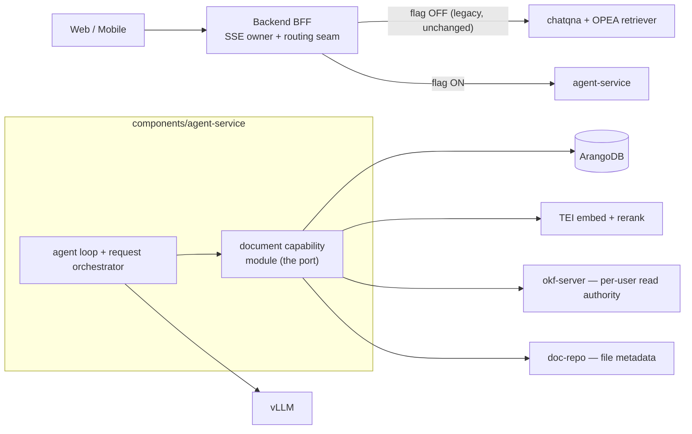

# Architecture Spine — Agentic Foundations (OPEA-free), iteration 1

## Design Paradigm

**Hexagonal (ports & adapters), behind a protocol-owning edge.**

- **Port** — the *document capability contract*: the only way any agent logic
  touches knowledge. Input/result/provenance/error semantics per operation,
  versioned, cancellation + limits per operation (FR-1..FR-5).
- **Adapters** — the OPEA-free implementations behind the port: ArangoDB
  queries, TEI embedding/reranking, okf-server authorization resolution,
  doc-repo metadata lookups.
- **Application** — the agent loop orchestrator: budgets, cancellation,
  citation verification, event emission. It consumes the port and nothing else.
- **Protocol-owning edge** — the Node BFF owns the client SSE dialect. The
  agent service speaks the BFF's internal JSON event dialect; the frontend
  contract never leaks past the BFF.

Map to code: port + adapters = `capabilities/`, application = `agent/`,
edge = existing `components/gov-chat-backend`.

## Invariants & Rules

Dependency direction — the diagram is the rule:



Rules the diagram carries: the loop never bypasses the port; the port never
calls vLLM; nothing inside agent-service imports `comps` or calls an OPEA-built
service; the frontend never talks to anything but the BFF.

### AD-1 — OPEA-free is structural, not disciplinary

- **Binds:** FR-6, FR-20, FR-21, FR-22; all agent-path packages.
- **Prevents:** an "OPEA-free with discipline" path that silently inherits
  `comps` (every `genie-ai-overlay/` Dockerfile clones GenAIComps at build).
- **Rule:** All agentic-path code lives outside `genie-ai-overlay/` (in
  `components/`). CI gate (new `tests/config-validator/` test, following the
  established tree-walking gate pattern — exemplars: `e2e-stream-route`,
  `e2e-handle-locators`, `ci-shell-gates`) fails the pipeline on
  `comps`/OPEA imports or OPEA build-time downloads in agent-path packages —
  **including the BFF's agentic routing branch** — from the first delivered
  stage. No agentic-routed request invokes an OPEA-built service at any hop
  (FR-20); the OPEA translation image is covered by this ban (AD-14). The
  BFF leg (Node, imports nothing) is enforced by a **routing-helper test**,
  not a grep: the agentic branch must never target the chatqna/OPEA URL —
  the legacy branch keeps its call by design. FR-21 adds an explicit
  no-new-OPEA-coupling check at each stage gate's review. "OPEA-free"
  claims are scoped to validated surface only (FR-22).

### AD-2 — One new Python service hosts port and loop

- **Binds:** SC-01, OQ-6, D01 host, FR-23 config B.
- **Prevents:** a language split that strands the designated runtime fallback
  (pydantic-ai is Python-only) or forces a hand-rolled Node tool-calling
  client.
- **Rule:** `components/agent-service` — Python, FastAPI, stdlib+own deps,
  pattern of `pii-service` (non-overlay Python precedent), internal-only port,
  compose-standard service block. The document capability module and the agent
  loop are separate modules in this one service, joined only by the port API.
  Python chosen harness-independently: host + tools exist under every D03
  outcome (custom loop, pydantic-ai, DSH via Python SDK).

### AD-3 — Contract placement: port module inside agent-service; okf-server stays the authority

- **Binds:** D01, FG-1, FR-1..FR-8, NFR-7.
- **Prevents:** a second authorization/knowledge-governance layer; a Node
  rewrite of the retrieval machinery (silent divergence from recorded
  behavior).
- **Rule:** The document capability contract is a module with a stable
  internal API (working ops: `search_knowledge`, `read_source`) inside
  agent-service. okf-server remains THE per-user read authority
  (scope-authz/access-control/authz-resolver, servingReads family) — unchanged.
  The port receives the per-request **trusted caller context** (user id +
  resolved authorized graph set, structured fields — never the `search_start`
  compression) already assembled by the BFF, and queries **only** that set:
  enforcement by construction. On authorization-resolution failure: error or
  insufficient-evidence — never a wider corpus (the legacy fail-open window is
  not replicated). No raw AQL from model-generated arguments (okf-011); any
  graph/repo identifier from a caller is charset-validated or resolved
  server-side (repo_id → graph_name). Agent-facing contract surfaces expose
  **no OPEA-specific representations** (FR-7) — ids, provenance and errors
  are GENIE vocabulary. Iteration 2 may lift the module out to a
  dedicated service at this seam. **Premise check:** V04 (authorization,
  provenance and ownership map across existing services) confirms this
  placement at contract acceptance; a V04 divergence reopens this AD and
  AD-4, not just the stories.

### AD-4 — Authorization intersection, enforced in the executor

- **Binds:** FR-2, FR-12, FR-28, NFR-1.
- **Prevents:** model-generated arguments widening access; permissive
  fallbacks; an agent that gains permissions beyond its user.
- **Rule:** Effective permissions = user ∩ task over the **registered
  toolset**; the server-side tool registry IS the authorization surface (the
  model can call nothing unregistered). The user is the actor
  (impersonation semantics — neither party gains). Enforcement lives in the
  port's executor with per-request identity. Degraded retrieval (partial
  availability, fallback strategy) reports insufficiency as insufficiency —
  never a confident answer. `read_source` re-validates every resolved target
  (file_id via doc-repo, concept via okf-server/`okf_concepts_meta`) against
  the request's authorized graph set — live-service lookup alone is not
  enforcement. Mapping for the legacy corpus: a legacy `file_id` belongs to
  the shared legacy GRAPH (no per-user ACL) — it is in-scope iff the
  request's authorized set includes the legacy graph (i.e. the resolution
  context allowed legacy retrieval at all). Retained evidence/session/audit
  data carries ownership and
  access rules (cross-user and between-turns permission-change attempts are
  tested).

### AD-5 — Runtime seam: the loop is replaceable behind a stable interface

- **Binds:** D03 (deferred pick), NFR-7, FR-9.
- **Prevents:** runtime choice leaking into the port, the SSE dialect, or the
  budgets — making the D03 swap expensive.
- **Rule:** Whatever drives the loop (custom loop / pydantic-ai / DSH SDK
  subprocess) plugs onto: (a) server-registered tool definitions, (b) an
  internal event stream shaped on the AG-UI taxonomy (run lifecycle, text
  deltas, tool-call lifecycle, state — pattern, not dependency), (c) budget
  and cancellation hooks. **The internal envelope is
  `{run_id, call_id, seq, kind, payload}`, owned by the `agent/` module —
  runtimes never emit BFF frame names.** The internal event vocabulary and
  the tool/operation names are **owned by the seam**: a
  runtime swap adapts its native events to that vocabulary — it never renames
  it. The D03 decision closes at S4 entry from V06 + V07a and must not close
  on research evidence past its 2026-12-01 compat re-check without a refresh.
  Every candidate documents dependency boundaries and replacement scope with
  measured or estimated swap cost (NFR-7). **pydantic-ai is the runner-up
  HYPOTHESIS** (PRD NFR-7, addendum §D) — a swap-in spike is optional
  evidence, not an obligation; "≤1 day" is a hypothesis to measure, never a
  prescribed test target.

### AD-6 — Bounded execution and cancellation are owned by the request orchestrator

- **Binds:** FR-11, NFR-3, CM-3.
- **Prevents:** unbounded agent loops; budgets that only count the happy path;
  cancellation that never reaches the model call.
- **Rule:** **Two-level budget ownership.** The **BFF owns the true
  end-to-end request deadline** — it is the only component alive for the
  whole lifecycle (agent phase + translation + finalization). The agent
  orchestrator owns the **agent-phase sub-budget**: step cap, agent-phase
  wall-clock deadline (communicated in the request), per-run token budget,
  model/tool-call count, evidence volume. **Everything counts**: retries,
  tool invocations, auxiliary model calls (translation, classification, the
  grounding judge). Translation runs on the **residual**: the BFF starts no
  translation call beyond the remaining deadline, cancels the downstream
  translate call on client disconnect, and accounts token usage — estimated
  where the backend discards it (the existing `gpu-translate-backend`
  returns only translated strings and has its own 30s timeout; it must
  return usage or be wrapped with an estimate). The BFF's upstream timeout
  on the agent leg is configured ≥ the agent-phase deadline plus margin —
  the pair is validated in the V08 rollback rehearsal, so a long agent run
  is never misattributed as a BFF timeout (CM-3). Cancellation chain: BFF
  detects client disconnect on the stream (replacing the dead
  `req.on('close')` path) → aborts the upstream call → agent-service cancels
  the in-flight model call. Admission control against shared vLLM/TEI: a
  concurrency bound using the repo's **flock slot-pool idiom**
  (dataprep precedent, `genieai_dataprep_microservice.py:118-147` — note:
  that idiom is **intra-container only**; its locks live in the container's
  `/tmp` and compose declares dataprep a SINGLE-REPLICA CONTRACT,
  docker-compose.yaml:2834 — the `deploy:` block of `dataprep-arango-service`).
  **Iteration-1 deployment contract: the
  activation flag runs agent-service at exactly one replica (0 or 1)** —
  with one replica, the slot pool IS the global bound (429 only when all
  slots busy); scaling beyond one replica requires an explicitly shared
  coordination mechanism with failure/lease semantics and a verified
  topology, and is deferred until that mechanism exists. **Every** request
  mode passes through the lane, including the no-agent evaluation mode
  (AD-10), so admission policy never becomes a hidden variable in E02.
  Auxiliary model calls (grounding judge, classification, translation)
  emit **no** `agent_activity` event — the line reports tool calls, not
  plumbing. **Document-tool calls dispatch serially** (one in flight) in
  iteration 1 — auxiliary calls may overlap; this keeps the client event
  projection unambiguous (AD-8) while FR-11 still counts parallel-capable
  behavior for whatever the runtime attempts. Saturation behavior defined
  before S4. Numeric thresholds are post-baseline (PRD §8).

### AD-7 — Citation enforcement: mechanical reference validity + judged grounding, behind a named release policy

- **Binds:** FR-10, FR-13, FR-25, REC-5.
- **Prevents:** prompt-only citation enforcement (measured to make invention
  worse); a streaming lie (unverifiable content presented as grounded).
- **Rule:** Two checks, one pipeline. **Reference validity** — inline,
  mechanical, no LLM: every emitted citation resolves to an authorized,
  actually-retrieved stable source id; always on; cannot be disabled by
  policy. **Grounding** — a judged check at finalize (one budgeted call;
  fallback verdict `unverified`, never `grounded`). Release policy is a named,
  deployment-level enum (`verdict-marked` | `verdict-silent` |
  `hold-until-verified`); iteration 1 ships `verdict-marked`: stream normally,
  verdict + explicit `agent_verdict` correction event on failure (position
  pinned by AD-8), persisted marking — never silent. `verdict-silent` means
  no separate streamed event — the verdict is **always** surfaced on the
  answer surface (answer-level warning + persisted marking); no policy value
  hides a failed verification from the user (FR-10/FR-12). Changing policy =
  versioned additive SSE event + re-measured evaluation, not per-request
  switching; no policy value disables verification. **Verdict tri-state and
  projection (single source of truth):** the verdict is
  `grounded | ungrounded | unverified`; the `metadata` frame carries
  `grounding_status` (tri-state) and the legacy boolean `is_grounded`
  derived from it (`true` iff `grounded`; the tri-state exists so new
  clients distinguish "verification could not complete" from "not supported
  by sources" — `unverified` must never render the ungrounded warning's
  claim). The client's unconditional `metadata` handling can never overwrite
  a failed verdict with a confident one. **Verdict scope:** the verdict
  certifies the **source-language answer text it evaluated**; a delivered
  translation is a different representation — `metadata` records the
  translation mode, and a translated answer never silently inherits
  `grounded` as a claim about the translated text (iteration 1 does not
  re-judge translations; the persisted record and UI mark the distinction).
  Citations render through the existing RAG citation components.

### AD-8 — The BFF owns the SSE contract; extensions are additive and versioned

- **Binds:** FR-14, FR-30, D04, NFR-5.
- **Prevents:** a second client contract; breaking old clients when the agent
  path activates.
- **Rule:** The five client event types (`chunk`, `metadata`, `translation`,
  `done`, `error`) are preserved verbatim. Iteration 1 adds exactly two new
  event types — `agent_activity` (tool-call started/completed + operation
  name from the registered toolset, no raw reasoning) and `agent_verdict`
  (AD-7 outcome) — both additive, explicitly versioned, and ignored by
  clients that don't know them. **Pinned positions:** `agent_activity` frames
  interleave with `chunk`s; `agent_verdict` is emitted after the last `chunk`
  and **before** `metadata`; `done` is always the last frame. The `metadata`
  frame's `source_documents` array keeps its existing shape (including the
  `okf-concept` variant) so existing citation components and post-rollback
  re-render work unchanged. **Frame writer:** agent-service emits the
  internal seam stream (AD-5 envelope); the **BFF parses it and writes every
  client frame** — chunk relay, translation injection (AD-14), metadata
  emission + version-record persistence (AD-11), `done`/`error`. The
  bytes-repr dialect dies with chatqna; agent-service never writes a client
  frame. Translation
  compatibility carries over in both modes (translated units as `chunk`
  frames when streaming translation is on; `done.translationFailed`
  semantics preserved; backend per AD-14). The SSE e2e envelope stays
  single-sourced (`tests/e2e/helpers/stream-route.js`); every new event type
  extends it and pins its spec to the local run set. **Reconciliation:** the
  five-type list above is reconciled against the V05 live-contract inventory
  at the S3 compatibility gate; a V05 discrepancy reopens this AD.

### AD-9 — Activation is one deployment-level flag covering both request paths; rollback is rehearsed

- **Binds:** FR-15, FR-16, NFR-4, V08.
- **Prevents:** half-activated deployments (one path agentic, one legacy);
  untestable rollback.
- **Rule:** One activation flag (pattern: `OKF_ENABLED` — compose replicas +
  BFF routing) switches BFF routing for BOTH request paths — `POST
  /api/queries/stream` (entry `initStreamQuery`) and non-stream `POST
  /api/queries` (entry `createQuery`, a **separate** code path). The branch
  lives in one shared routing helper both entries call, with a test asserting
  the two paths cannot disagree — literal per-entrypoint edits are the
  half-activated deployment this AD exists to prevent. The agentic path mints
  a `queries`-collection doc (same shape) so persistence, analytics,
  saved-conversation citations, and rollback continuity (agentic conversation
  continued on legacy) work without data changes. Every stage rollout records
  consumers, versions, in-flight treatment, rollback triggers with a named
  responsible operator, and rehearsal evidence. Venue note: the compose
  venue is governed here; the k3s umbrella chart (read-only
  `feat/k8s-migration`) is operator-owned — chart adoption must carry the
  same flag semantics.

### AD-10 — The OPEA-free search preserves recorded query-path behavior

- **Binds:** FR-8, V02, E01, FR-23.
- **Prevents:** accidental divergence from required RAG behavior that E01 only
  discovers late.
- **Rule:** Before the contract is accepted, V02 records the OPEA
  retriever/embedding query-path semantics **as deployed** — RRF k, BM25
  analyzer, label-filter strategy are env-tunable values
  (`retriever/config.py:122,133,93` — RRF k, BM25 analyzer, label-filter
  strategy), not constants; the port preserves the recorded
  values and exposes the same knobs. Behavior set to preserve: dense cosine
  (brute-force default), BM25 view, RRF fusion, label filter +
  defense-in-depth post-filter, file_id enrichment, CAP-1 identity join
  tolerated-absent. The **query-instruction embedding prefix**
  (`get_query_instruction` per embedding model) is mandatory on every query
  embedding — omitted prefixes silently corrupt dense scores. **V02 scope
  includes the query/history preparation pipeline** — the current path
  detects the conversation language, translates non-English history/queries
  to English BEFORE embedding (English-only embedding space), applies
  history/input bounds, and records `query_translation_status`
  (`genieai_chatqna.py:4663/4689/4972`). **Input-preparation ownership
  (resolves the port/vLLM boundary):** the **agent application layer (the
  loop)** owns query/history preparation — language detection,
  translate-to-English BEFORE each `search_knowledge` call (including every
  refined query generated mid-loop), bounds, failure/overflow behavior,
  status provenance (`query_translation_status`). The loop may call vLLM
  (paradigm diagram); preparation calls are auxiliary model calls — budgeted
  (AD-6), cancellation-chained, and invisible to the activity line. The
  **port's input contract requires prepared (English) queries** and carries
  the preparation status in results — the port itself never calls vLLM
  (unchanged). Answer translation stays BFF-owned (AD-14). Configs B/C use
  identical preparation so the E02 delta attributes to the agent. **Method:
  reimplementation, not code sharing** — a **clean-slate port**: modern
  patterns (typed port/adapters, DI, testable units) are encouraged where
  needed, but **behavior is frozen** to the V02-recorded semantics in
  iteration 1 so E01 attributes every difference to nothing; behavioral
  improvements are iteration-2 work with evidence (addendum F). The port is
  new Python in agent-service; no shared library, no wrapping, no dual-mode
  code with the OPEA overlay (a shared lib would restructure the
  comps-vendoring build and couple the paths — FR-21; the bounded
  duplication ends by deletion at the deferred OPEA-exit initiative, never
  by merging). Evaluation
  config B (fixed pipeline over the new capabilities) = a no-agent mode of
  the same service: a single-pass port call through the same orchestrator
  admission lane and the same budgets — B and C share the retrieval backend
  and admission policy exactly, so the E02 delta attributes to the agent.

### AD-11 — Observability and audit through the existing stack, with versioned execution records

- **Binds:** FR-17, FR-18.
- **Prevents:** a parallel observability silo; unexplainable executions.
- **Rule:** agent-service ports the overlay `tracing.py` pattern **minus its
  guarded `comps` hooks** — the ported file must itself pass the AD-1 gate —
  first non-overlay Python service with OTel traces, plus the fluentd logging
  anchor and the `OTEL_SERVICE_NAME` compose↔source pair convention.
  Namespace `genie-core`-family, per-service name. **Version handshake
  (FR-17, every execution):** agent-service emits a **run-start seam event**
  carrying the execution-version record (implementation, model, prompt,
  configuration ids); the BFF persists it into the `queries` doc AT START
  (the doc already exists, `isAnswered:false`); the final metadata frame
  carries the completed record and the terminal outcome. Cancelled,
  timed-out or crashed runs therefore keep their versions and an honest
  terminal/interrupted state — no execution is left unattributable because
  the final frame never arrived. RAG-pipeline spans follow the existing W3C
  traceparent propagation conventions; no credentials or unnecessary
  sensitive content in records.

### AD-12 — No new persistence: existing stores, unchanged shapes

- **Binds:** §4.1 persistence scope, FR-16 rollback, PRD §12 assumption.
- **Prevents:** a session/audit store that breaks rollback continuity or adds
  an migration burden.
- **Rule:** The agentic path writes only through the existing shapes:
  `queries` collection per turn (BFF, unchanged), `conversations`/`messages`/
  `conversationFiles`/`queryMessages` on user-initiated save (unchanged).
  Agent-internal session state stays in-request (iteration 1 is read-only);
  nothing agent-specific is required for the legacy path to continue a
  conversation after rollback.

### AD-13 — Tainted-data discipline: retrieved content is data, never instructions

- **Binds:** FR-25, FG-2, AD-4.
- **Prevents:** prompt injection — an agent steered by instructions embedded
  in retrieved documents or tool outputs.
- **Rule:** Tool results cross the port as **structured data** (typed fields,
  stable ids, bounded sizes); the port defines no free-form instruction
  channel. The agent must not act on instructions originating from retrieved
  content — system-prompt grounding plus the structured contract make
  instruction-following from corpus content a deviation. The evaluation set
  includes hostile instructions embedded in retrieved documents and tool
  outputs (FR-25); a document attempting to steer the agent counts as a
  finding regardless of outcome.

### AD-14 — Answer translation on the agentic path: BFF-executed, vLLM backend only

- **Binds:** FR-14, FR-11 counting semantics, AD-1, AD-6, AD-8, AD-10.
- **Prevents:** an OPEA-free violation through the translation back door (the
  CPU translation backend is the OPEA-built `opea/translation` image), and
  unattributed translation cost. **Scope: this AD governs ANSWER translation
  only** — input/query preparation translation is loop-owned (AD-10) as an
  auxiliary budgeted call.
- **Rule:** On the agentic path, translation runs in the BFF against the
  **vLLM GPU backend** (existing `gpu-translate-backend` pattern) — the OPEA
  translation image is never invoked (AD-1). The BFF translation module is
  **shared code**: the legacy path may keep the CPU/OPEA backend, so the
  static gate does not grep it — enforcement is the backend selection keyed
  on the routing flag (agentic-routed request ⇒ vLLM backend, asserted by
  config check + covered by an e2e spec), not import hygiene. Translation
  runs on the **residual budget under the BFF's end-to-end deadline**
  (AD-6): no translation call starts beyond the remaining deadline,
  disconnect cancels the downstream call, and usage is returned or
  estimated (the backend's string-only response and private 30s timeout do
  not satisfy this unchanged); accounting lands in the AD-11 execution
  record. Streaming and non-streaming translation modes keep AD-8
  semantics.

## Consistency Conventions

| Concern | Convention |
| --- | --- |
| Naming | Service dir `components/agent-service`; image `genie-ai-agent-server`; env prefix `AGENT_*`; capability ops `search_knowledge`, `read_source` (working names, versioned at contract acceptance); SSE event names stay lowercase single words. |
| Stable source ids | Legacy: `file_id` (resolves via doc-repo `GET /api/files/:id`) — carried in the frame as the `document_id` field's value, `source` absent (legacy branch). OKF: `concept_id` + `repo_id` + `bundle_version`, resolved by exact join on `okf_concepts_meta` — never by graph-name parsing — and carried with `source: 'okf-concept'` (without it the frontend takes the legacy branch and builds a 404 doc-repo URL, `conversation.js:239-296`). `chunk_key` rides metadata; it is not a persisted citation id. |
| Trusted caller context | Structured fields: user id (`iss_sub`) + authorized graph set + task restrictions. Never the `search_start` compressed string (one string, four concerns). Bearer tokens are forwarded only where a downstream service enforces its own validation (okf-server, doc-repo). |
| Errors & insufficiency | Insufficient evidence is a **successful answer type**, not an error; authorization failures never fall back more permissively; degraded availability reports insufficiency. Error events keep the existing SSE `error` frame semantics. |
| Config | Hand-wired compose `environment:` blocks (no `env_file` in this repo); every new var documented in the root `env` template and covered by `tests/config-validator/` (AC2/AC4); activation flag gates compose + routing together. |
| Timestamps | UTC ISO (`toISOString`) everywhere persisted, matching existing services. |
| Capacity | Lane-cap via flock slot pools (dataprep idiom, intra-container). Iteration-1 deployment contract: agent-service runs at exactly ONE replica (flag-gated 0/1) — the slot pool is then the global bound. Multi-replica requires an explicitly shared coordination mechanism (deferred); not cgroups — compose defines no resource limits. |
| Dependency adoption | Before ANY runtime/dependency is adopted: audit its **defaults** — default telemetry, default cloud export, license posture — against the exact package version (NFR-2; V07a). Developer-preview status requires an explicit operational-risk acceptance. |
| Decision records | Structural decisions land as ADRs with the FR-29 discipline (status Proposed/Accepted/Rejected/Superseded, date, owner, reviewers, evidence, reconsideration triggers; superseded records preserved and linked; one canonical home per record). This spine's ADs follow the same status discipline; existing ADRs are status-checked before reliance. |

## Stack

SEED — true at cold-start; the code owns it once it exists. Versions match
repo-pinned values at S3 start unless a decision supersedes.

| Name | Version |
| --- | --- |
| Python | 3.11 (project standard, `pii-service` precedent) |
| FastAPI | as pinned in repo at S3 start (`pii-service` precedent) |
| openai SDK (`AsyncOpenAI`) | as pinned in repo at S3 start (dataprep precedent; base_url `VLLM_ENDPOINT/v1`) |
| ArangoDB python driver | as pinned in repo at S3 start; hand AQL copied from recorded retriever semantics |
| TEI client | plain HTTP, as in okf-server Node precedent / overlay usage |
| Agent runtime (D03) | **undecided** — S4 entry; candidates: custom loop (provisional), pydantic-ai 2.68.0 (fallback, web-verified 2026-11-16, compat re-check 2026-12-01 gates its use), DSH SDK subprocess (assessment outstanding) |
| vLLM | v0.29.0 (compose-pinned; tool-calling prerequisites per REC-6 bind V06) |

## Structural Seed

Deployment shape (both venues: Swarm compose and k3s chart):

- agent-service: internal-only port, `genieai_network`, fluentd anchor,
  healthcheck (Python urllib pattern), `cap_drop`/`no-new-privileges`,
  replicas gated by the activation flag; placement with the genieai (non-GPU)
  pool.
- No new host ports, no new external providers, no new stores. GPU services
  (vLLM, TEI) shared and unchanged.

Minimal source tree:

```text
components/agent-service/
  app/            # FastAPI host: health, internal API, event stream out
  capabilities/   # the port: operations, executor, authz-context,
                  # provenance, limits; adapters: arango, tei, okf, docrepo
  agent/          # loop orchestrator, runtime seam, budgets, cancellation,
                  # citation verifier, event shaping
  obs/            # tracing port (tracing.py pattern, no comps)
  tests/          # pytest; contracts/ sibling for real-endpoint checks
```

## Capability → Architecture Map

| Capability / Area | Lives in | Governed by |
| --- | --- | --- |
| FG-1 document capability contract | `capabilities/` module, agent-service | AD-2, AD-3, AD-4, AD-10; paradigm port |
| FG-2 governed agent (SC-01) | `agent/` loop + orchestrator | AD-5, AD-6, AD-7 |
| FG-3 chat integration, activation, rollback | BFF routing seam + activation flag | AD-8, AD-9 |
| FG-4 governance, audit, compliance | CI gate + obs + queries-doc records | AD-1, AD-11, AD-12 |
| FG-5 evaluation infrastructure (configs A/B/C) | no-agent mode + existing legacy path; protocol/harness in `tests/rag-benchmarks` (ratified home) | AD-10, AD-2 |
| FG-5 protocol requirements (FR-24/26/27 — eval-set composition, versioning, reporting) | eval-harness feature at story level | Deferred (design at story breakdown) |
| FG-2 prompt-injection defense | port structured results + eval scenarios | AD-13 |
| NFR-2 sovereignty/licensing | dependency adoption rules + V07a | AD-1, AD-5 (candidates doc swap cost) |
| NFR-3 coexistence + admission | orchestrator lane caps | AD-6 |
| NFR-6 CI/runner availability | new CI surface: agent pytest suite + AD-1 gate; availability confirmed by V09 | Deferred (V09, release-gate acceptance) |

## Deferred

Each item names the reason it can wait.

- **D03 runtime pick** — closes at S4 entry from V06 + V07a; not closable on
  research past its 2026-12-01 compat re-check without a refresh. The seam
  (AD-5) is what must hold until then.
- **Budget/threshold numerics** — post-baseline per PRD §8; absence blocks
  promotion, never hidden behind defaults.
- **Evaluation protocol design (FR-24 set composition/versioning, FR-26
  defect recording, FR-27 reporting)** — a feature of the eval harness
  (home: `tests/rag-benchmarks`), designed at story breakdown; the spine
  governs only the A/B/C configurations (AD-10) and the injection scenarios
  (AD-13).
- **V03 deployed baseline** (versions, digests, models, topology) —
  operations-owned input to the E01 reference; recorded before baseline
  measurement.
- **V07b full license/redistribution assessment** — pre-release gate
  (pilot/release using the artifacts); V07a pre-adoption checks bind earlier
  at every dependency adoption (NFR-2).
- **V09 CI/runner availability** — confirmed at release-gate acceptance; the
  spine adds CI surface (agent pytest suite, AD-1 gate) that V09 must cover.
- **FR-28 historical visibility of earlier answers after a source is revoked**
  — an explicit product-policy decision (recorded, not defaulted), taken with
  the persistence/audit story; not defaulted by the architecture.
- **D04 contract-versioning detail beyond SSE** — the SSE half is bound
  (AD-8); the port's versioning rules finalize at contract acceptance (S3)
  from the V05 inventory.
- **D05 release gates + pilot scope** — PRD-level decision fed by baseline
  measurement and V09.
- **Workflow layer (static or dynamic)** — iteration 2 scope review; iteration
  1 delivers the seams it plugs into (the port, the runtime seam, the host as
  composition root). No orchestrator groundwork shipped.
- **OPEA exit for the legacy stack** — separate initiative; carry-over list in
  PRD addendum §E. Ingestion stays OPEA; the agentic path is read-only.
- **Retrieval-strategy comparison (lexical/vector/hybrid)** — iteration 2+;
  requires six-dimension evidence (addendum F); embeddings/vector indexes are
  not removable by decision.
- **Per-user/tenant activation granularity; rich activity display (expandable
  tool calls)** — iteration 2 evolutions on contract-stable surfaces.
- **First end-to-end validation venue; evaluation-threshold home + E01/E02
  sign-off** — open PRD questions (§13-1, §13-5), not architecture's to close.
