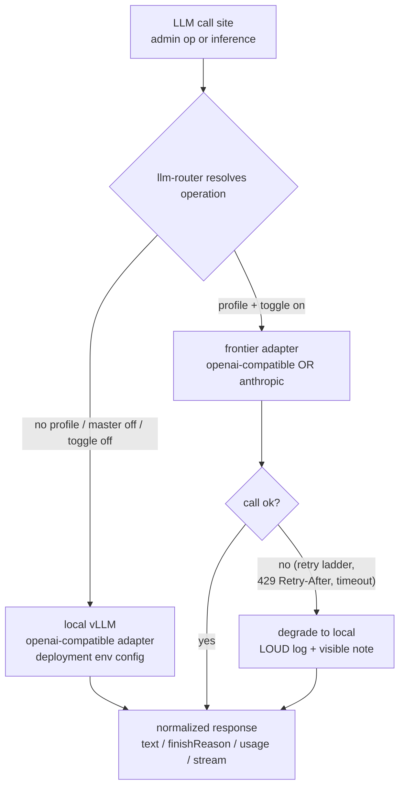
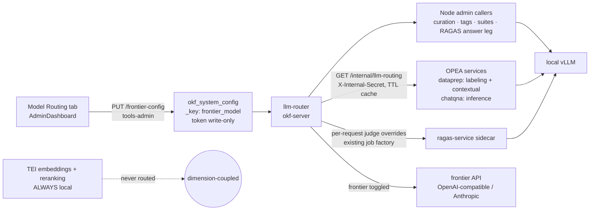
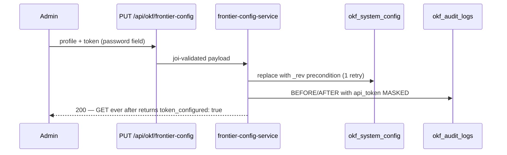

# Architecture diagrams — frontier-model routing

Companion to SPEC.md. Mermaid; diagrams live in this companion per Spec Law.

## Decision flow — every LLM call in the framework

## Propagation topology

## Config write path (secret safety)

