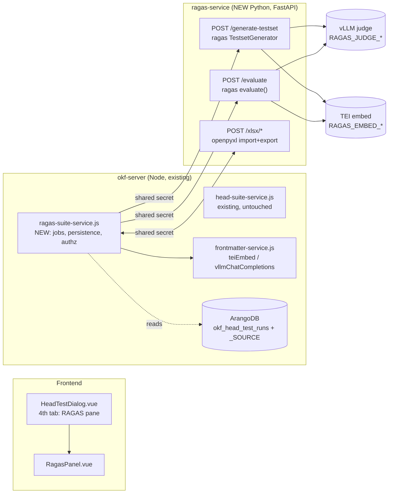
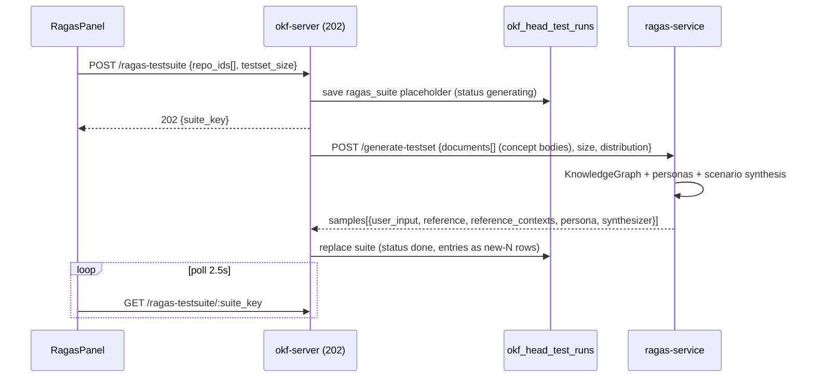
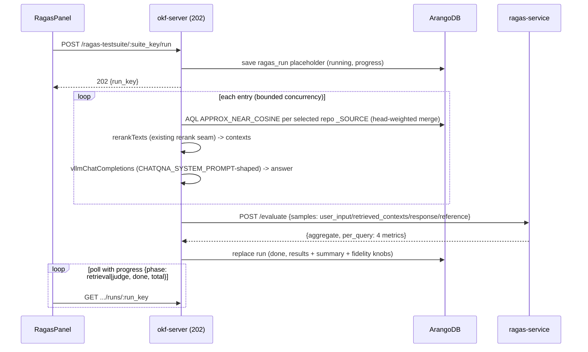
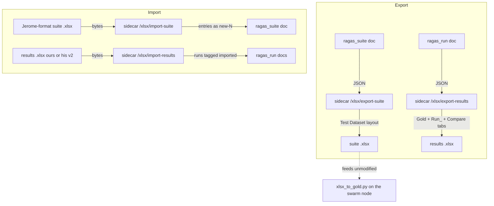
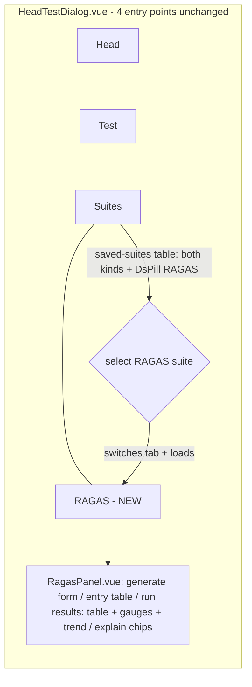

# Architecture diagrams — RAGAS benchmarking (Story 8-6)

All diagrams are the additive delta on the existing Routing Lab (`head-test-service` + `head-suite-service`). No existing arrow changes.

## Service topology

## Suite generation flow (CAP-1)

## Run flow (CAP-3) — Lab-internal replay, never chatqna-over-HTTP

## xlsx interchange (CAP-2)

## UI placement (CAP-4/5/6)

