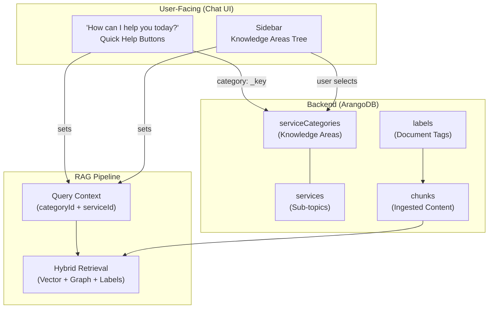

# Knowledge Areas, Quick Help & Content Retrieval

This document explains how **Knowledge Areas**, **Quick Help buttons**, and **document labels** work together to deliver context-aware responses in the GENIE.AI platform.

---

## Overview

The platform uses three interconnected systems to scope and improve RAG (Retrieval-Augmented Generation) responses:

| System | Purpose | Managed By | Stored In |
|--------|---------|------------|-----------|
| **Knowledge Areas** | Define the topics the chatbot covers | Admin Dashboard → Knowledge Hierarchy | `serviceCategories` + `services` collections |
| **Quick Help Buttons** | Landing page shortcuts into Knowledge Areas | `genie-ai-config.json` + i18n translations | Static config file |
| **Document Labels** | Tag ingested content for retrieval filtering | Admin Dashboard → Document Management | `labels` collection (document-repository DB) |



---

## Knowledge Areas

### What They Are

Knowledge Areas are the **topic domains** that the chatbot can assist with. They appear in the sidebar as a browsable tree and are used to scope queries to relevant content.

They are stored in ArangoDB as a two-level hierarchy:

- **Level 1: Categories** (`serviceCategories` collection) — broad topic domains
- **Level 2: Services** (`services` collection, linked via `categoryServices` edges) — specific sub-topics

### Example (Lesotho Agriculture Advisory)

```
Crop Management                    ← Knowledge Area (category, _key: "1")
  ├── Seasonal Planting Guide      ← Service (sub-topic)
  ├── Crop Rotation                ← Service
  └── Seed Selection               ← Service

Livestock & Animal Husbandry       ← Knowledge Area (category, _key: "2")
  ├── Disease Prevention           ← Service
  ├── Feeding & Nutrition          ← Service
  └── Breeding Programs            ← Service

Climate & Weather                  ← Knowledge Area (category, _key: "3")
  ├── Seasonal Forecasts           ← Service
  └── Climate Adaptation           ← Service
```

### How They Affect RAG Responses

When a user selects a Knowledge Area (either via Quick Help or the sidebar tree):

1. The `categoryId` (and optionally `serviceId`) is attached to the query as context.
2. The backend uses this to:
   - Filter or boost retrieval results related to that domain.
   - Traverse the knowledge graph along relevant edges.
   - Tag the conversation for analytics tracking.
3. The conversation is linked to the Knowledge Area via a graph edge (`conversationCategories`).

### Managing Knowledge Areas

**Admin Dashboard → Knowledge Hierarchy** tab:

- **Add Category**: Create a new top-level Knowledge Area.
- **Add Service**: Add a sub-topic under a category.
- **Edit**: Rename categories or services.
- **Delete**: Remove categories (and their children) or individual services.
- **Translations**: Add multilingual names for each item (displayed based on user's locale).

### Database Collections

| Collection | Type | Purpose |
|---|---|---|
| `serviceCategories` | Document | Top-level Knowledge Areas (has `catCode`, `order`) |
| `services` | Document | Sub-topics within categories |
| `categoryServices` | Edge | Links categories → services (with `order`) |
| `serviceCategoryTranslations` | Document | Multilingual names for categories |
| `serviceTranslations` | Document | Multilingual names for services |
| `conversationCategories` | Edge | Links conversations → categories |
| `queryCategories` | Edge | Links individual queries → categories |

---

## Quick Help Buttons ("How can I help you today?")

### What They Are

The Quick Help buttons are the **landing page tiles** shown when a user opens a new chat. They provide one-click entry points into specific Knowledge Areas, each sending a pre-configured prompt.

### How They Relate to Knowledge Areas

Each Quick Help button has a `category` field that **directly references a Knowledge Area by its `_key`** from the `serviceCategories` collection:

```json
{
  "id": "identity-civil",
  "title": "quickhelp.applyForID",
  "category": "1",              ← References serviceCategories._key = "1"
  "prompt": "quickhelp.applyForIDPrompt",
  "icon": { "type": "file", "value": "/config/quickhelp/identity-civil.svg" },
  "styles": { ... }
}
```

The special `"category": null` value (used by "Just Chat") means no Knowledge Area is pre-selected — the user gets a general conversation.

### What Happens When a User Clicks a Quick Help Button

1. The `category` ID is set as `currentCategoryId` on the chat component.
2. A context item is added: `{ service: "Crop advice", category: "1" }`.
3. The `prompt` translation is sent as the first message (e.g., "What crops grow best in my region of Lesotho this season?").
4. All subsequent queries in that conversation carry this category context.
5. The RAG pipeline uses the category to scope retrieval.

### Configuration

Quick Help buttons are defined in **two places** that must stay in sync:

**1. Button layout and category mapping** — `/public/config/genie-ai-config.json`:
```json
{
  "features": {
    "chat": {
      "quickHelp": {
        "buttons": [
          {
            "id": "crop-advice",
            "title": "quickhelp.applyForID",
            "icon": { "type": "file", "value": "/config/quickhelp/identity-civil.svg" },
            "category": "1",
            "prompt": "quickhelp.applyForIDPrompt",
            "styles": {
              "backgroundColor": "#D3E0EA",
              "hoverColor": "#A3BFFA",
              "outlineColor": "#87CEEB"
            }
          }
        ]
      }
    }
  }
}
```

**2. Display text and prompts** — `src/i18n/locales/en.js` (and other locale files):
```javascript
quickhelp: {
  applyForID: "Crop advice",                    // Button label
  applyForIDPrompt: "What crops grow best in my region of Lesotho this season?",  // Auto-sent message
  justChat: "Just Chat",
  justChatPrompt: "I'd like to chat about agriculture and farming in Lesotho"
}
```

### Important: Keeping Quick Help in Sync with Knowledge Areas

The `category` values in `genie-ai-config.json` are **hardcoded `_key` references** to the `serviceCategories` collection. If you:

- **Add/remove Knowledge Areas** in the Admin Dashboard → you may need to update `genie-ai-config.json` to add/remove buttons or fix category IDs.
- **Re-import the database** with different `_key` values → all Quick Help buttons will break unless the config is updated.

> **Tip**: After setting up your Knowledge Hierarchy, note the `_key` values assigned to each category and use those in your config file.

---

## How Knowledge Areas Differ from Document Labels

These are **separate systems** that serve different purposes:

| Aspect | Knowledge Areas | Document Labels |
|--------|----------------|-----------------|
| **Purpose** | Define what the chatbot *talks about* (user navigation) | Define how *documents are tagged* (retrieval filtering) |
| **User interaction** | Users browse/select in sidebar or Quick Help | Admins assign during upload; LLM auto-assigns during ingestion |
| **Stored in** | `serviceCategories` / `services` (backend DB) | `labels` collection (document-repository DB) |
| **Affects retrieval** | Scopes the query context sent to RAG | Filters which chunks are considered during retrieval |
| **Managed via** | Admin Dashboard → Knowledge Hierarchy | Admin Dashboard → Document Management (per-file) |
| **Granularity** | Broad topics (max 2 levels) | Fine-grained tags (category + service labels, unlimited) |

### How They Work Together

In practice, both systems contribute to retrieval accuracy:

1. **User selects a Knowledge Area** (e.g., "Crop Management") → sets the query context.
2. **RAG pipeline retrieves chunks** → uses vector similarity + knowledge graph traversal.
3. **Document labels on chunks** (e.g., "Maize", "Planting Season") → provide additional filtering signals.
4. **Combined scoring** produces the final ranked results.

For best results, your Knowledge Areas and document labels should be **conceptually aligned** but don't need to be identical. Knowledge Areas are broad user-facing categories; labels are detailed content tags.

---

## Setting Up for a New Deployment

### Step 1: Define Your Knowledge Areas

Plan your topic hierarchy based on your domain. For agriculture:

```
1. Crop Management
   - Seasonal Planting
   - Crop Rotation
   - Seed Selection
2. Livestock & Animal Husbandry
   - Disease Prevention
   - Feeding & Nutrition
3. Climate & Weather
   - Seasonal Forecasts
   - Climate Adaptation
4. Soil & Water Management
   - Irrigation Techniques
   - Soil Fertility
5. Pest & Disease Control
   - Identification
   - Organic Solutions
6. Market & Trade
   - Current Prices
   - Selling Channels
7. Government Programs
   - Subsidies
   - Extension Services
8. Farming Best Practices
   - Conservation Agriculture
   - Post-Harvest Handling
```

### Step 2: Create Knowledge Areas in the Admin Dashboard

1. Go to **Admin Dashboard → Knowledge Hierarchy**.
2. Click **"Add New Category"** for each top-level area.
3. Add services (sub-topics) under each category.
4. Add translations for each supported language.
5. Note the `_key` values assigned to each category.

### Step 3: Configure Quick Help Buttons

1. Edit `/public/config/genie-ai-config.json`.
2. For each button, set the `category` field to the `_key` of the corresponding Knowledge Area.
3. Update `src/i18n/locales/*.js` files with button labels and prompts in each language.
4. Add SVG icons to `/public/config/quickhelp/`.

### Step 4: Upload and Label Content

1. Go to **Admin Dashboard → Document Management**.
2. Upload your domain documents.
3. Assign labels that align with your Knowledge Areas (or let the LLM auto-label during ingestion).
4. Ingest the documents.

### Step 5: Verify

- Open a new chat and confirm Quick Help buttons appear with correct labels.
- Click each button and verify the chatbot responds with domain-relevant content.
- Check the sidebar tree shows your Knowledge Areas.
- Confirm analytics track usage per Knowledge Area.

---

## API Endpoints (for developers)

### Knowledge Areas (Service Categories)

| Method | Route | Description |
|--------|-------|-------------|
| GET | `/api/services/categories?locale=en` | Get all categories with services (public, for sidebar) |
| GET | `/api/service-categories/categories/detailed?locale=en` | Get categories with full service objects (admin) |
| GET | `/api/services/categories/:id?locale=en` | Get a single category with its services |
| GET | `/api/services/search?query=crop&locale=en` | Search categories and services |
| POST | `/api/service-categories` | Create a new category |
| PUT | `/api/service-categories/:id` | Update a category |
| DELETE | `/api/service-categories/:id` | Delete a category and its services |
| POST | `/api/service-categories/:id/services` | Add a service to a category |
| PUT | `/api/service-categories/services/:id` | Update a service |
| DELETE | `/api/service-categories/services/:id` | Delete a service |
| GET | `/api/service-categories/:id/translations` | Get translations for a category |
| GET | `/api/service-categories/services/:id/translations` | Get translations for a service |

---

## Summary

```
┌─────────────────────────────────────────────────────────────────┐
│                        USER EXPERIENCE                           │
├─────────────────────────────────────────────────────────────────┤
│                                                                 │
│  "How can I help you today?"     Sidebar Tree                   │
│  ┌──────────┐ ┌──────────┐      ┌─────────────────────┐        │
│  │ Crop     │ │ Soil &   │      │ ▶ Crop Management   │        │
│  │ advice   │ │ fertil.  │      │ ▶ Livestock         │        │
│  └────┬─────┘ └────┬─────┘      │ ▶ Climate & Weather │        │
│       │             │            └──────────┬──────────┘        │
│       │             │                       │                   │
│       └──────┬──────┘───────────────────────┘                   │
│              │                                                  │
│              ▼                                                  │
│     categoryId sent with query                                  │
│              │                                                  │
├──────────────┼──────────────────────────────────────────────────┤
│              │           RAG PIPELINE                            │
│              ▼                                                  │
│  ┌─────────────────────┐    ┌──────────────────────┐           │
│  │ Knowledge Graph      │    │ Vector Store          │           │
│  │ (serviceCategories,  │    │ (chunks with labels)  │           │
│  │  services, edges)    │    │                       │           │
│  └──────────┬───────────┘    └──────────┬───────────┘           │
│             └────────────┬──────────────┘                       │
│                          ▼                                      │
│              Ranked, context-aware response                      │
└─────────────────────────────────────────────────────────────────┘
```
