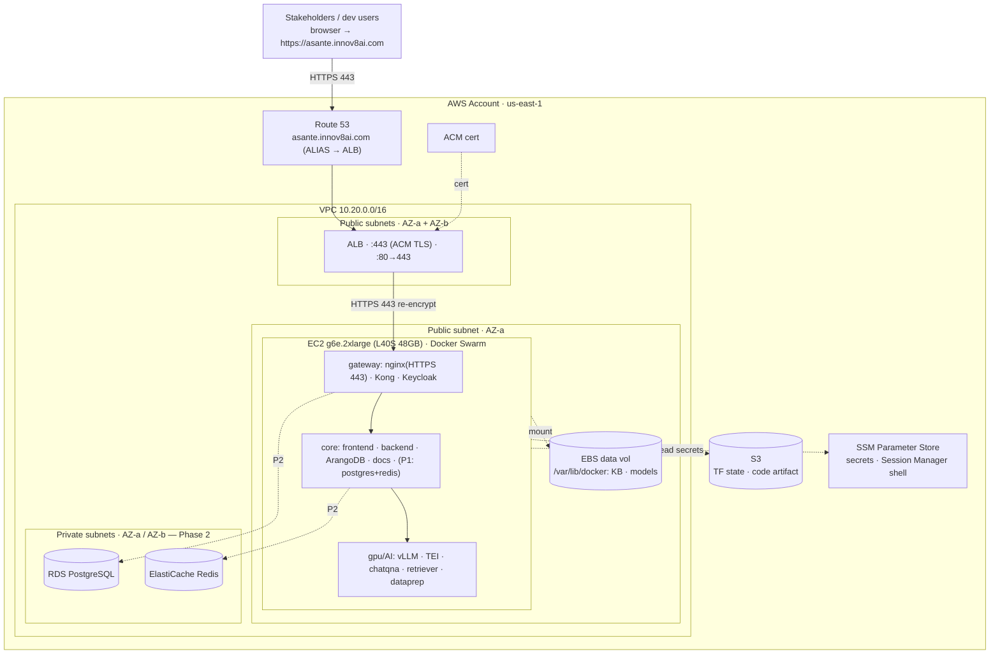

# GENIE.AI ("HealthBOT") — AWS Dev Deployment Plan (Terraform)

> **Scope:** a single **dev / stakeholder-demo** environment on AWS, provisioned with
> **Terraform**, in region **us-east-1**. This is *not* production (no HA, no auto-scaling,
> single instance). It must, however, **actually run the full RAG chatbot** live at
> **https://asante.innov8ai.com** so stakeholders can use it.
>
> **Companion docs:** [`deployment-options.md`](deployment-options.md) (production
> cost/quality options), [`aws-orchestration-decision.md`](aws-orchestration-decision.md)
> (the Swarm-vs-ECS decision + sign-off), [`aws-dev-deployment-status.md`](aws-dev-deployment-status.md)
> (current-state snapshot), [`deploy/terraform/README.md`](../deploy/terraform/README.md)
> (usage).

---

## 1. Decisions locked in

| # | Question | Decision |
|---|----------|----------|
| 1 | Purpose / AI strategy | **Dev demo to stakeholders** → the AI must work. **Self-host** the models on a GPU instance. Default **Qwen2.5-3B on `g6e.2xlarge`** (B1); one-variable bump to **Llama-3.1-8B on `g6e.4xlarge`** (B2). |
| 2 | DB & cache | Terraform `data_backend` flag: **start `embedded`** (bundled postgres + redis-cache containers) → **switch to `external`** (managed **RDS** + **ElastiCache**) later. See Phases 1 & 2. |
| 3 | Orchestration | **Option 1 — single-node Docker Swarm** now; **Option 2 — Hybrid ECS** documented as a later re-platform (§13). |
| 4 | Terraform → app handoff | Terraform provisions infra; `user_data` pulls the code (S3 zip) and runs the existing **Ansible playbook** on the box. |
| 5 | DNS + TLS | Real domain `asante.innov8ai.com` via **Route 53 + ACM** ⇒ **ALB** in front (managed, auto-renewing TLS). |
| 6 | Region / state | **us-east-1** · Terraform state in **S3**. |
| 7 | Auto-stop scheduler | **Configurable** (variable-toggled). |
| 8 | Code delivery | **S3 zip** built by Terraform from the working tree (no git clone/token on the box). |

**Resolved:** `innov8ai.com` **is** a Route 53 hosted zone in the account **and correctly
delegated** (registrar NS match the zone) → ACM DNS validation works.
**Still open (non-blocking, variables):** allowed **source IPs** for the ALB; final **B1 vs B2**.

---

## 2. Deployment phases & how to apply them

The rollout is a linear sequence — **P0 → P1 → P2 → P3** — from "demo fast" to a fully
**AWS-native platform**. It maps onto the
[orchestration decision](aws-orchestration-decision.md): **Option 1 (Docker Swarm)** covers
**P0–P2**; **Option 2 (Hybrid ECS)** is **Phase 3** below.

| Phase | Goal | Infra footprint | Apply | Cost/mo (auto-stop) |
|-------|------|-----------------|-------|---------------------|
| **P0 — Prerequisites** | Make the account deploy-ready | *None yet* (account, quota, state bucket) | Manual | — |
| **P1 — All-in-one (embedded)** | Full working stack for the demo | 1 GPU EC2 + ALB/ACM/Route 53 + EBS + SSM + S3; **DB/cache in containers** | `terraform apply` (`data_backend=embedded`) | ~$530 |
| **P2 — Externalize data** | Durable managed DB/cache | P1 **plus RDS + ElastiCache** | flip `data_backend=external` + `apply` | ~$575 |
| **P3 — Drop Swarm → ECS** | AWS-native orchestration (no Swarm) | ECS **Fargate** (app) + **GPU EC2** (inference); reuses P1/P2 edges | build to **ECR** + `apply` (new `ecs` module) | ~$760 |

---

### Phase 1 — All-in-one (embedded) — the demo target

**Goal:** the entire GENIE.AI stack running on **one GPU EC2**, reachable at
`https://asante.innov8ai.com`, with **DB and cache as bundled containers** (no managed
services). This is the stakeholder demo, and it deliberately avoids the managed-DB
integration risks (they don't exist in embedded mode).

**Infra created (Terraform, `data_backend="embedded"`):**

| Module | Resources |
|--------|-----------|
| `network` | VPC `10.20.0.0/16`, 2 public + 2 private subnets, IGW, route tables, 4 security groups (ALB / EC2 / RDS / Redis — the last two created but unused until P2) |
| `dns_tls` | ACM cert for `asante.innov8ai.com` (DNS-validated) + Route 53 records |
| `alb` | Application Load Balancer, target group (**HTTPS→nginx:443**), 443 + 80→443 listeners, Route 53 ALIAS |
| `compute` | 1× `g6e.2xlarge` GPU EC2 (whole stack, incl. **bundled postgres + redis-cache**), root EBS 50 GB, **data EBS 200 GB** (mounted at `/var/lib/docker`), IAM role/profile |
| `secrets` | ~13 `random_password` + HF token + admin email → **SSM Parameter Store** |
| `artifact` | S3 artifacts bucket + the zipped working tree uploaded to it |
| `scheduler` | *(optional)* EventBridge stop/start |

**Not created in P1:** RDS, ElastiCache (that's P2).

**Process**
```bash
cd deploy/terraform
cp terraform.tfvars.example terraform.tfvars
#   set: hugging_face_hub_token, genie_admin_email, allowed_ingress_cidrs
#   keep: data_backend = "embedded", region = "us-east-1", aws_profile = "healthbot-dev"
terraform init
terraform apply
```
Then watch the first boot (~20–40 min: apt + 13 image builds + model download):
```bash
aws ssm start-session --region us-east-1 --target "$(terraform output -raw instance_id)"
sudo tail -f /var/log/genieai-bootstrap.log   # then: docker service ls
```

**Validation:** ALB target turns **healthy**; `https://asante.innov8ai.com` loads and
**login works** (Keycloak); a chat query returns a grounded answer.

**Gate to P2:** demo is stable *and* you want DB/cache durability beyond the instance.

---

### Phase 2 — Externalize data (managed RDS + ElastiCache)

**Goal:** move PostgreSQL and Redis off the box to managed AWS services so they survive
instance loss and are operationally standard. (ArangoDB stays on the box — no managed
equivalent.)

**Infra added / changed (flip `data_backend="external"`):**

| Change | Detail |
|--------|--------|
| **+ RDS PostgreSQL** | `db.t4g.small`, private subnets, **custom parameter group `rds.force_ssl=0`** so Kong/Keycloak connect |
| **+ ElastiCache Redis** | `cache.t4g.micro`, **AUTH + in-transit TLS** |
| **+ subnet groups** | DB + cache subnet groups (private subnets, ≥2 AZs) |
| **App repoint** | `KONG_PG_HOST`/`KC_DB_URL` → RDS; `TRANSLATION_CACHE_HOST` + `TRANSLATION_CACHE_TLS=on` → ElastiCache; bundled `postgres`/`redis-cache` containers scaled to 0 |

The RDS/Redis **security groups already exist from P1**, so P2 only adds the data services
themselves.

**Process**
```bash
# set data_backend = "external" in terraform.tfvars
terraform apply                 # creates RDS + ElastiCache (~10 min)
# re-run the box bootstrap so it picks up the managed endpoints + scales down containers:
terraform apply -replace="module.compute.aws_instance.this"   # data EBS persists across this
```

**Validation:** Kong + Keycloak connect to RDS (no SSL error); `postgres-init` created the
kong/keycloak databases; the translation cache connects to ElastiCache over TLS. *If the
ioredis TLS handshake fails on ElastiCache's cert, set `rejectUnauthorized:false` (dev) or
supply the ElastiCache CA — non-fatal (chat still works, translation just isn't cached).*

---

### Phase 3 — Drop Docker Swarm → ECS Fargate + GPU EC2

**Goal:** retire single-node Docker Swarm for **AWS-managed orchestration** (the decision
doc's **Option 2**). The CPU/app tier becomes **serverless on ECS Fargate** (2 AZs,
self-healing); only the GPU inference stays on an EC2 (Fargate has no GPU). This is the
production-shaped target platform.

**Prerequisite:** Phase 2 — Fargate has no local disk, so the app tier assumes **external**
RDS + ElastiCache. (ArangoDB stays on EC2 in every phase — no managed equivalent.)

**Infra added / changed (new `ecs` module; the Swarm `compute` node retired):**

| Change | Detail |
|--------|--------|
| **+ ECS cluster** | one cluster, two capacity providers: **Fargate** (app) + an **EC2 GPU** Auto Scaling group (inference) |
| **+ Fargate services** | the ~25 CPU containers (frontend, backend, Kong, Keycloak, chatqna, retriever, dataprep, doc-repo, …) as ECS task definitions/services |
| **+ GPU EC2 (ECS)** | `g6e.2xlarge` ECS container instance running vLLM / translation / TEI as GPU-reserved tasks — **no Swarm** |
| **+ ArangoDB task** | EBS-backed ECS-on-EC2 task (stateful; may co-locate on the GPU instance for dev) |
| **+ Cloud Map** | private DNS service discovery (replaces Docker's built-in DNS) |
| **+ ECR** | images built in CI and pushed to ECR (replaces build-on-box + the S3 zip) |
| **ALB retarget** | the existing target group points at the **Fargate** service instead of the EC2 — same listener, cert, DNS |
| **− Docker Swarm** | the `compute` instance + its `user_data` / Ansible / S3-zip bootstrap is removed |

**Reused unchanged:** `network`, `data` (RDS + ElastiCache), `dns_tls`, `alb`, `secrets`,
`scheduler`. The network, DNS/TLS edge, and managed data layer don't change — Phase 3 is
**additive**, not a rebuild.

**Process (outline)**
```bash
# 1. CI builds the ~13 images and pushes them to ECR (no more build-on-box)
# 2. terraform apply   # new modules/ecs: cluster, task defs + services, Cloud Map, GPU ASG
# 3. cut the ALB target group over to the Fargate service (blue/green or straight swap)
# 4. remove module.compute (the Swarm EC2)
```

**Effort:** ~5–8 days (per the decision doc). **Cost:** ~$760/mo with cost controls — the
Fargate tier + its networking bill continuously, so it's harder to fully switch off than P1/P2.

**Validation:** ECS services healthy across 2 AZs; the ALB serves from Fargate; login + chat
work end-to-end; GPU tasks scheduled on the EC2 capacity provider; **no Swarm running**.

---

## 3. What runs, and where it lands

GENIE.AI is a ~36-container stack that runs as a **single-node Docker Swarm** (the existing
Ansible tooling). On this one dev box the `gateway`, `genieai`, and `gpu` node labels all
apply to the **same** instance:

| Tier | Containers | Placement |
|------|-----------|-----------|
| `gateway` | **nginx (serves HTTPS:443, self-signed; the ALB re-encrypts to it)**, Kong, Keycloak | On EC2 |
| `genieai` (core) | Vue frontend, Node backend, **ArangoDB** (KB + vectors), doc-repository, ClamAV | On EC2 |
| `gpu` (AI) | **vLLM (chat)**, translation LLM, TEI embed/rerank, retriever, dataprep, chatqna | On EC2 (GPU) |
| PostgreSQL (Kong/Keycloak) | **P1:** bundled container · **P2:** → RDS | On EC2 / RDS |
| Redis (translation cache) | **P1:** bundled container · **P2:** → ElastiCache | On EC2 / ElastiCache |

> **ArangoDB stays on the box** in every phase (no managed equivalent). Its Docker volume
> lives on the **persistent data EBS** (mounted at `/var/lib/docker`), so the EC2 is
> disposable — replace it without losing the KB or re-downloading models.

---

## 4. Architecture diagram

Solid = Phase 1 (embedded). Dashed = **Phase 2** additions (managed data).



---

## 5. AWS resource inventory (by phase)

| Resource | Size (dev default) | Phase | Notes |
|----------|--------------------|-------|-------|
| EC2 | `g6e.2xlarge` (8 vCPU, 64 GB, L40S 48 GB) | P1 | Bump to `g6e.4xlarge` for B2. GPU quota + driver AMI required. |
| Root EBS | gp3 50 GB (encrypted) | P1 | OS + bootstrap. |
| Data EBS | gp3 200 GB (encrypted) | P1 | `/var/lib/docker`: ArangoDB, model cache, images. Persists across instance replace. |
| ALB + ACM + Route 53 | — | P1 | :443 re-encrypt to nginx; :80→443; DNS-validated cert; ALIAS. |
| VPC / subnets / IGW | 10.20.0.0/16, 2 pub + 2 priv | P1 | No NAT (EC2 in public subnet, egress via IGW). |
| Security groups | ALB / EC2 / RDS / Redis | P1 | RDS/Redis SGs created in P1, used in P2. EC2: 443 from ALB SG only; no SSH. |
| SSM Parameter Store | ~15 SecureString | P1 | TF-generated secrets. |
| S3 (artifacts) | 1 bucket | P1 | Zipped code the instance pulls. |
| S3 (TF state) | 1 bucket | P0 | Manual bootstrap. |
| IAM role/profile | — | P1 | SSM core + SSM param read + S3 GetObject + logs. |
| EventBridge scheduler | optional | P1 | Auto stop/start, `enable_scheduler`. |
| **RDS PostgreSQL** | `db.t4g.small`, 20 GB | **P2** | + parameter group `rds.force_ssl=0`. |
| **ElastiCache Redis** | `cache.t4g.micro` | **P2** | AUTH + TLS. |

> **No Elastic IP** — the ALB is the stable endpoint; the EC2's public IP is outbound-only
> and inbound is locked to the ALB SG. Instance stop/start keeps the private IP the ALB targets.

---

## 6. Terraform layout

Implemented under `deploy/terraform/` (validated with `terraform validate`):

```
deploy/terraform/
├── versions.tf providers.tf backend.tf variables.tf locals.tf main.tf outputs.tf
├── artifact.tf                # zip the working tree -> S3 (code delivery)
├── terraform.tfvars.example   README.md
└── modules/
    ├── network/    VPC · subnets · IGW · routes · 4 security groups
    ├── dns_tls/    ACM cert (DNS-validated) · Route 53 records
    ├── alb/        ALB · target group (HTTPS) · 443+80 listeners · ALIAS
    ├── data/       RDS + ElastiCache (+ param/subnet groups) — count-gated (P2)
    ├── secrets/    random_password × N → SSM SecureString
    ├── compute/    GPU EC2 · data EBS · IAM · user_data bootstrap
    └── scheduler/  optional EventBridge stop/start
```

---

## 7. Bootstrap flow (`user_data` → Ansible → stack)

1. **SSM agent** installed/enabled first (SSM is the only shell — no SSH).
2. **Mount the data EBS** at `/var/lib/docker` by filesystem **LABEL** (EBS-only; never the
   ephemeral instance store; survives stop/start + instance replacement).
3. **Pull code** — `aws s3 cp` the artifact zip + extract to `/opt/genieai`; local
   `git init` (for the build's image labels); `skip_git_sync=true` so Ansible doesn't clone.
4. **Fetch secrets** from SSM → render Ansible `group_vars` (managed-DB wiring only in
   `external` mode; `nginx_public_domain` + Keycloak https URLs always).
5. **Run the playbook** (`ansible_host` = the private IP for `swarm init`) — installs Docker
   + NVIDIA container toolkit, inits Swarm, builds the 13 images, deploys the stack.
6. **P2 only:** scale the bundled `postgres`/`redis-cache` services to 0.

> First boot ~20–40 min. Optional **Packer AMI** (Docker + NVIDIA pre-baked) cuts it to
> minutes later — not required for the demo.

---

## 8. Secrets handling

Terraform-generated, stored in SSM (replaces the manual Ansible Vault step):

| Secret | Source | Consumed by |
|--------|--------|-------------|
| RDS master pw, `KONG_DB_PASSWORD`, `KEYCLOAK_DB_PASSWORD` | `random_password` → SSM | RDS/postgres-init, Kong, Keycloak |
| `ARANGO_PASSWORD`, `SESSION_SECRET`, `TRANSLATION_CACHE_PASSWORD`, Keycloak client secrets ×4, `genie_admin_password` | `random_password` → SSM | app stack |
| `genie_admin_email` | **you supply** → SSM | realm admin |
| `HUGGING_FACE_HUB_TOKEN` | **AWS Secrets Manager** `innov8ai/asante/hf-token` (JSON key `HF_TOKEN`) — the instance reads it at runtime via IAM `GetSecretValue`; never enters Terraform state | vLLM/TEI/dataprep model pulls |

`TRANSLATION_CACHE_PASSWORD` doubles as the ElastiCache AUTH token in P2.

---

## 9. Integration status (previously "glue work" — now handled)

| Item | Status |
|------|--------|
| GPU driver AMI | ✅ Deep Learning Base GPU AMI auto-selected (ships drivers). |
| ALB ↔ nginx | ✅ **No app change** — ALB re-encrypts to nginx's HTTPS:443; Keycloak already proxy-ready (`KC_PROXY_HEADERS`/`KC_HOSTNAME`). |
| RDS force-SSL (P2) | ✅ `rds.force_ssl=0` parameter group. |
| Redis AUTH/TLS (P2) | ✅ ElastiCache AUTH+TLS + env-gated ioredis TLS + non-empty password (satisfies `NODE_ENV=production`). |
| `env.j2` / `postgres-init` | ✅ managed-DB vars added; `PGHOST` parameterized. |
| Data volume safety | ✅ EBS-only (skips ephemeral instance store), LABEL-based mount. |
| Swarm init | ✅ `advertise-addr` = private IP. |
| SSM shell | ✅ agent installed in `user_data`. |
| DNS/ACM | ✅ zone exists + delegated; validation automatic. |

---

## 10. Cost estimate (us-east-1)

| Item | 24/7 | Auto-stop (~220 h/mo) |
|------|------|-----------------------|
| EC2 `g6e.2xlarge` (~$2.24/h) | ~$1,637 | ~$493 |
| ALB | ~$18 | ~$18 |
| EBS (50 + 200 GB gp3) | ~$20 | ~$20 |
| Route 53 + ACM + S3 + transfer | ~$5–15 | ~$5–15 |
| **P1 subtotal** | **~$1,690** | **~$540** |
| + RDS `db.t4g.small` (P2) | +~$25 | +~$25 |
| + ElastiCache `cache.t4g.micro` (P2) | +~$13 | +~$13 |
| **P2 total** | **~$1,730** | **~$575** |

- **Auto-stop is the biggest lever** — a stopped GPU instance bills ~$0/hr compute
  (EBS/ALB/RDS still bill); the site is down while stopped (start it before a demo).
- **B2** (`g6e.4xlarge`) adds ~$0.76/hr.

---

## 11. Prerequisites, gotchas & compliance

1. **GPU quota** — the #1 first-deploy blocker (P0.2).
2. **Health data / HIPAA** — "HealthBOT" for Asante is healthcare. Everything is encrypted
   at rest (EBS/RDS/ElastiCache) and in transit (ACM/TLS). **If any real patient/PHI data
   is shown, get an AWS BAA + HIPAA scope review**; prefer synthetic/sample clinical content.
3. **Gated models** — Llama-3.1 & Gemma-3 are HuggingFace-gated; Qwen-3B is not (dev
   default). The HF token still needs **Gemma-3** access for translation.
4. **First boot is slow** (~20–40 min) — watch via SSM.

### AWS account handling (from Andy)
- Rotate the temporary password, enable **MFA**; use a named profile/SSO for Terraform;
  **never commit credentials**; don't paste credentials into chat/tickets.

---

## 12. Build status

- ✅ **Terraform implemented** in `deploy/terraform/`; **`terraform plan` succeeds against the
  live account — 59 to add, 0 change, 0 destroy** (Phase 1 / embedded). `validate`/`fmt` pass;
  live-account checks done (AMI, g6e AZ, engine versions, DNS delegation).
- ✅ **App deploy-plumbing edits** (`env.j2`, `docker-compose.yaml`, `translation-service.js`,
  `deploy.yml`) — backward-compatible, inert in embedded/on-prem.
- ✅ **Phase 0 mostly done:** AdministratorAccess granted; S3 state backend
  (`innov8ai-asante-state`) configured; HF token in Secrets Manager; orchestration confirmed.
- ⏳ **Only blockers to `apply`:** the **GPU quota** (AWS case open) and the **admin email** (Andy).
- Not yet verified by a live `apply` / first boot — the Ansible-on-DLAMI run is the
  least-tested part (watch via SSM).

---

*(The ECS / Option 2 migration is documented as **Phase 3** in §2 above.)*
