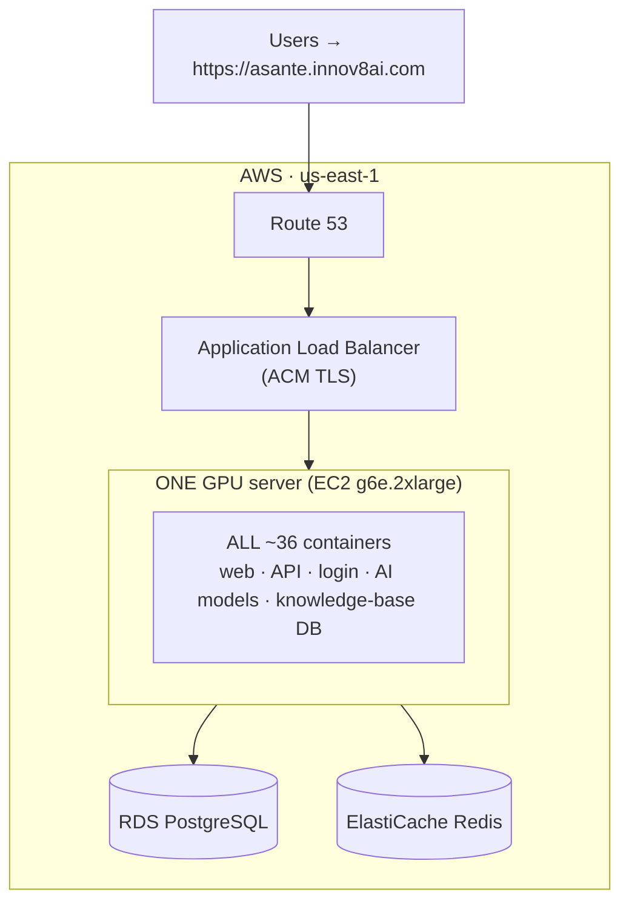
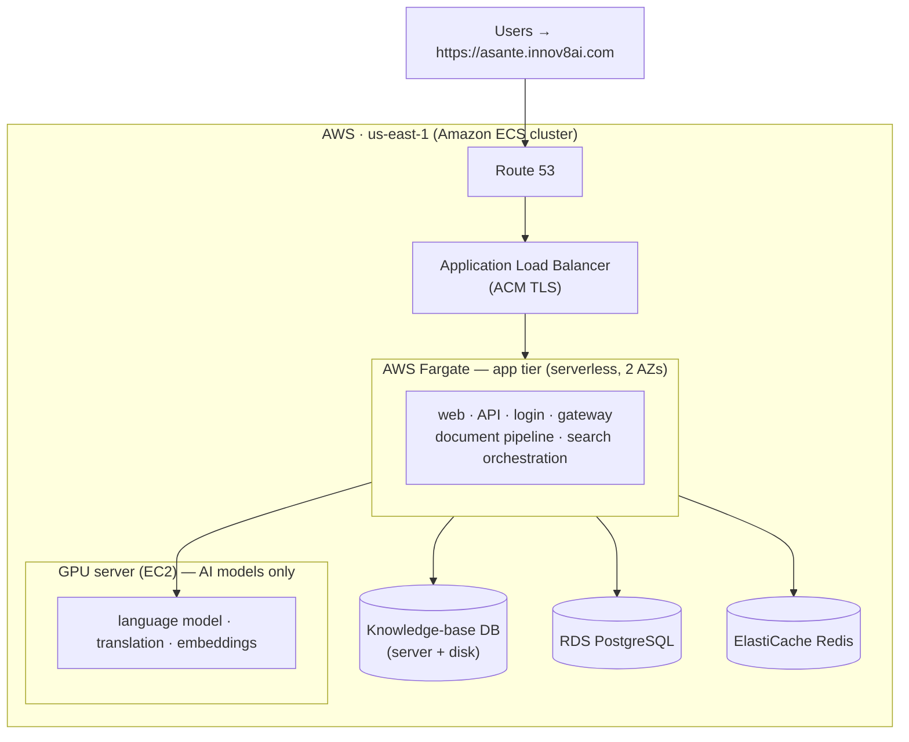

# GENIE.AI "HealthBOT" — Deployment Orchestration Decision

**Environment:** AWS dev / stakeholder-demo · region **us-east-1** · domain **https://asante.innov8ai.com**
**Prepared for:** stakeholder sign-off (Hank, Andy)
**Prepared by:** Infrastructure (Vitaly)
**Status:** ✅ **DECIDED — Option 1 (single-node Docker Swarm)**, rolled out in phases (P1 → P2 → P3). Approved by Andy Skumanich (2026-07-04) and **confirmed by Han Kyul Kim (2026-07-06)**.

---

## ⚠️ Decision required

We need to choose **how the ~36 application containers are orchestrated** on AWS. Everything
else about the environment is already agreed and is **identical** in both options (see
*Common foundation* below). This choice affects **cost, timeline, and how much the platform
can grow later** — so it needs a stakeholder decision before we build.

Two options are on the table:

| | Option 1 | Option 2 |
|---|----------|----------|
| **Name** | **Docker Swarm** (single node) | **Hybrid: ECS Fargate + GPU EC2** |
| **In one line** | Run everything on one GPU server, exactly as the software ships today | Run the app on AWS-managed serverless containers, with a separate GPU server only for the AI models |
| **Build effort** | ~1 day (already built) | ~5–8 days (new build) |
| **Est. cost (demo hours)** | **~$575/mo** | **~$760/mo** |
| **Best when** | Get the demo live fast & cheap | Build a lasting, AWS-native foundation |

---

## Background: what we're deploying

GENIE.AI ("HealthBOT") is an AI chatbot that answers questions from a curated knowledge
base. Technically it's a stack of ~36 containers: a web app + API, an identity/login layer,
a document-processing pipeline, a database, and — the expensive part — **AI models that
require a GPU** (the language model, translation, and search/embedding models).

### The one hard constraint (applies to both options)

**The AI models need an NVIDIA GPU, and AWS's fully-serverless container service (Fargate)
does not offer GPUs.** This means:

> **A GPU server (EC2 instance) is unavoidable in *both* options.** No design lets us run
> the AI models "serverless." The only question is how the *rest* of the stack is run.

Also: the knowledge-base database (ArangoDB) has **no managed AWS equivalent**, so it runs
on a server (with its data on a persistent, backed-up disk) in both options.

### Common foundation (identical in both options)

To keep the comparison honest, these are already decided and **do not change** between
options:

- **Managed database & cache:** Amazon **RDS** (PostgreSQL) + **ElastiCache** (Redis).
- **Public entry & security:** **Application Load Balancer** with a managed **ACM** TLS
  certificate, **Route 53** DNS for `asante.innov8ai.com`.
- **Secrets, backups, logs:** AWS SSM Parameter Store, S3, CloudWatch.
- **Region:** us-east-1. **Provisioning:** Terraform.
- **Data protection:** encryption at rest and in transit throughout.

---

## Option 1 — Docker Swarm (single node)

Run the entire stack on **one GPU server** using the orchestration the software already
ships with. This is the path the current detailed plan
([`aws-dev-deployment-plan.md`](aws-dev-deployment-plan.md)) implements.

**Pros**
- ✅ **Already built & proven** — the deployment automation exists and works today.
  Fastest and lowest-risk route to a live demo (~1 day of config).
- ✅ **Cheapest** — one server you can **fully switch off** outside demo hours (~$575/mo).
- ✅ **Stays in lock-step with the open-source project** — updates are easy to pull in.
- ✅ **Simple to reason about** — one box.

**Cons**
- ⚠️ **Docker Swarm is legacy technology** — still maintained, but the industry has moved
  to Kubernetes/ECS. Not where new investment goes.
- ⚠️ **Single point of failure** — if the one server fails, the whole demo is down until it
  restarts.
- ⚠️ **Not AWS-native orchestration** — no managed control plane; ops rely on Swarm-specific
  knowledge.
- ⚠️ **Does not scale** — a single node can't grow to production load without re-architecting
  (which effectively means doing Option 2 later anyway).

**Cost:** ~**$1,720/mo** running 24/7, or ~**$575/mo** with the auto-stop schedule (server
off nights/weekends). **Effort:** ~1 day. **Risk:** Low.

---

## Option 2 — Hybrid: ECS Fargate (app tier) + GPU EC2 (inference)

Split the stack along the GPU line and use **AWS-managed orchestration (Amazon ECS)**:

- The **~25 non-AI containers** (web app, API, login, document pipeline, gateway) run on
  **AWS Fargate** — *serverless* containers, no servers to patch or manage, spread across
  two Availability Zones.
- The **AI models** (language model, translation, embeddings) run on a **GPU server** as
  part of the same ECS cluster.
- The **knowledge-base database** runs on a small server with a persistent, backed-up disk.

**Pros**
- ✅ **Most AWS-native** — managed control plane (ECS), serverless app tier, native
  integration with load balancing, secrets, logging, and access control.
- ✅ **No Docker Swarm** — modern, declarative in Terraform, transferable skills.
- ✅ **More resilient app tier** — spread across two Availability Zones; failed containers
  are auto-replaced.
- ✅ **A real foundation for production** — this is the architecture you'd grow, not throw
  away.

**Cons**
- ⚠️ **Significant build effort (~5–8 days)** — the 36 services must be re-authored as ECS
  definitions, with new AWS-managed service discovery, one-time setup jobs, and storage
  wiring. More moving parts = more that can surprise us on demo day.
- ⚠️ **Still needs a GPU server** — Fargate can't run the AI models, so we don't escape
  managing at least one instance.
- ⚠️ **Higher cost, harder to switch off** — the serverless app tier and its networking
  keep running (and billing) even when the GPU server is stopped.
- ⚠️ **Diverges from the open-source project** — future updates must be re-mapped into the
  AWS definitions each time (ongoing maintenance).

**Cost:** ~**$2,040/mo** running 24/7, or ~**$760/mo** with cost controls (GPU server
stopped + app tier scaled down off-hours; some networking bills continuously). **Effort:**
~5–8 days. **Risk:** Medium.

---

## Side-by-side comparison

| Criterion | Option 1 — Swarm | Option 2 — Hybrid ECS + GPU EC2 |
|-----------|------------------|----------------------------------|
| Orchestration | Docker Swarm (single node) | Amazon ECS (Fargate + EC2) |
| AWS-native | Edges only (ALB, RDS, etc.) | **Yes — managed control plane** |
| Uses Docker Swarm | **Yes** | **No** |
| GPU server required | Yes (all-in-one) | Yes (AI only) |
| Resilience (app tier) | Single point of failure | **Multi-AZ, self-healing** |
| Build effort | **~1 day (exists)** | ~5–8 days (new) |
| Time to live demo | **Fastest** | Slower |
| Cost — 24/7 | **~$1,720/mo** | ~$2,040/mo |
| Cost — demo hours | **~$575/mo** | ~$760/mo |
| Can fully switch off | **Yes (one server)** | Partly (app tier bills on) |
| Tracks open-source updates | **Easily** | Manual re-mapping |
| Path to production scale | Re-architecture needed | **Grows naturally** |
| Delivery risk | **Low** | Medium |

---

## Recommendation (for consideration)

**The right choice depends on what this environment is really for:**

- **If it is genuinely a short-lived demo** — to show stakeholders the product working —
  then **Option 1 (Swarm)** is recommended: it's live in ~1 day, costs the least, can be
  switched off between sessions, and carries the least delivery risk. Swarm being "legacy"
  is a non-issue for a demo that runs on one box.

- **If this environment is intended to become the seed of the production platform** — i.e.
  we'll keep building on it — then **Option 2 (Hybrid ECS)** is the better investment
  despite the higher upfront effort and cost, because Option 1 would eventually have to be
  rebuilt as Option 2 anyway.

**A sensible middle path:** run the demo on **Option 1 now**, and adopt **Option 2 as a
Phase 2** once the product direction is confirmed. This gets stakeholders a working demo
immediately while keeping the AWS-native platform as a planned, funded next step rather
than a rushed one.

> Whatever is chosen, the *application itself is identical* — this decision is purely about
> the operational plumbing underneath it.

---

## Decision & sign-off

Please select one and confirm:

- [ ] **Option 1 — Docker Swarm (single node)** — fastest & cheapest for the demo
- [ ] **Option 2 — Hybrid ECS Fargate + GPU EC2** — AWS-native platform foundation
- [x] **Phased** — Option 1 for the demo now, Option 2 as Phase 2 — ✅ **SELECTED**

| Role | Name | Decision | Date |
|------|------|----------|------|
| Stakeholder | Han Kyul Kim | ✅ Confirmed — Option 1 | 2026-07-06 |
| Stakeholder | Andy Skumanich | ✅ Approved — Phased (Option 1 now, Option 2 as Phase 2) | 2026-07-04 |
| Infrastructure | Vitaly | Proceeding per Andy's recommendation | 2026-07-04 |

---

### After the decision

- **Option 1 chosen** → the detailed build plan is ready in
  [`aws-dev-deployment-plan.md`](aws-dev-deployment-plan.md); we proceed to Terraform.
- **Option 2 chosen** → that plan is revised for the ECS/Fargate split (new diagram,
  resource inventory, and a ~5–8 day build schedule), then we proceed to Terraform.

*Cost figures are estimates for us-east-1 and exclude data transfer; confirm against the
AWS pricing calculator before committing. "Demo hours" assumes the GPU server runs ~220
hours/month (business hours) rather than 24/7.*
