# How a chat query travels — and how the prompts get attached

**Verified against code 2026-10-22** — every step cites `file:line`. Two diagrams:
the **first query** of a thread, and **second/later queries** (where the K.7 history
blend and K.7b query reformulation wake up). Live mode on the box:
`CONTEXT_OPTION=conversation-with-context-labels` (compose default, [docker-compose.yaml:517](../../docker-compose.yaml#L517)).

---

## Diagram 1 — FIRST query in a thread

```mermaid
flowchart TD
    A["User types message<br/>(thread is empty)"] --> B["Frontend builds wire payload<br/>wireMessages = real turns only, last 20 cap<br/>→ at this point: exactly ONE message<br/>ChatBotComponent.vue:1038-1061"]
    B --> C["POST /api/queries/stream (SSE)<br/>Bearer attached · streamingService.js:67"]
    C --> D["Node backend /stream route<br/>buildOpeaPayload('conversation-with-context-labels')<br/>forwards FULL messages + context{categoryLabel,<br/>serviceLabels, language, weatherLocation}<br/>query-service.js:241-251 · query-routes.js:305-316"]
    D --> E["chatqna handle_request<br/>1. Bearer → JWKS validation (401 on bad token;<br/>no header → continues anonymous)<br/>2. GET /api/me/context → user profile<br/>genieai_chatqna.py:3646-3677"]
    E --> F["Language resolution<br/>context.language > request.language ><br/>langdetect on last user msg → EN fallback<br/>genieai_chatqna.py:3700-3788"]
    F --> G["History blob (1 segment only)<br/>'USER: <original text>'<br/>non-EN → whole blob translated to EN first<br/>(cap 2000 chars) :3790-3805"]
    G --> H["K.7 blend input: history_text = ''<br/>(needs ≥2 segments — this is turn 1)<br/>_extract_history_text :304-322"]
    H --> I["K.7b reformulation: SKIPPED<br/>no prior history → returns None with<br/>ZERO LLM calls (no latency added) :345-363"]
    I --> J["retrieval_query = raw EN message"]
    J --> K["Weather RAG (auth-gated, keyword-triggered)<br/>geocode Lesotho place → POST /api/weather<br/>→ 'CURRENT WEATHER DATA' section :2347-2455"]
    K --> L["Embedding leg — SINGLE TEI call<br/>bge-m3 embeds the query alone (no blend)<br/>:1582-1595"]
    L --> M["Retriever — hybrid<br/>dense COSINE over GRAPH_SOURCE (label-filtered)<br/>+ BM25 over view → RRF fuse k=60 → top-20<br/>retriever_arangodb.py:1023-1191"]
    M --> N["Graph traversal (depth 2, ≥0.7, max 5)<br/>'RELATED INFORMATION' appended to chunks<br/>retriever_arangodb.py:1243-1320"]
    N --> O["Reranker (live: slice top-1 · knee in testing)<br/>TEI cross-encoder scores 20 → picks<br/>genieai_tei_reranker.py:427+"]
    O --> P["Prompt assembly (see anatomy below)<br/>_build_rag_prompt: docs FIRST, QUESTION last"]
    P --> Q["vLLM granite — streams tokens back"]
    Q --> R["Backend SSE → frontend bubble<br/>{queryId} {delta}* {done, metadata}<br/>metadata = source_documents + confidence<br/>query-routes.js:323-370"]
    R --> S{"user language<br/>≠ EN?"}
    S -- yes --> T["chatqna end-of-stream translation →<br/>{translation: final ST text} replaces bubble<br/>(or {translationNotice} if it failed) F4"]
    S -- no --> U["English answer stands"]
```



## Diagram 2 — SECOND and later queries in a thread

```mermaid
flowchart TD
    A["User sends follow-up<br/>(e.g. 'and what about in the mountains?')"] --> B["Frontend wire payload — NOW MULTI-TURN<br/>all real turns, last 20 cap (HISTORY_MESSAGE_CAP=20),<br/>UI-only bubbles filtered out, must OPEN on a user turn<br/>ChatBotComponent.vue:361,1038-1051"]
    B --> C["POST /api/queries/stream<br/>messages = [user, assistant, user, ...]"]
    C --> D["Backend forwards FULL thread + context<br/>(same conversation-with-context-labels path)"]
    D --> E["chatqna intake<br/>token → profile → language (same as turn 1)"]
    E --> F["History blob = whole thread flattened<br/>'USER: q1 |<-MSG->| ASSISTANT: a1 |<-MSG->| USER: q2'<br/>non-EN → translated to EN (2000-char cap)"]
    F --> G["K.7 blend: history_text = previous turn<br/>(MULTI_TURN_HISTORY_TURNS=1 → the prior<br/>assistant answer) :138-142, 3824-3838"]
    G --> H["K.7b REFORMULATION FIRES (every turn ≥2)<br/>granite rewrites the follow-up into ONE<br/>self-contained EN question (temp 0, ≤64 tokens,<br/>5s timeout) — 'and in the mountains?' →<br/>'When should maize be planted in the mountains<br/>of Lesotho?' :345-417"]
    H --> I["retrieval_query = REWRITTEN question<br/>(raw text still drives weather parsing +<br/>CHAT HISTORY section) :3847-3858"]
    I --> J["Weather RAG (same as turn 1)"]
    J --> K["Embedding leg — ONE BATCHED TEI call<br/>[query, history] → BLEND<br/>V = 0.7·EQ + 0.3·EH  (MULTI_TURN_BLEND_ALPHA)<br/>dense leg searches with V; BM25 leg still gets<br/>the ISOLATED rewritten string :1820-1835"]
    K --> L["Retriever hybrid + labels + traversal<br/>(same as turn 1, but dense vector is blended)"]
    L --> M["Reranker picks (slice top-1 / knee)"]
    M --> N["Prompt assembly — CHAT HISTORY section now<br/>carries the REAL prior turns in the user's<br/>ORIGINAL wording (the rewrite never enters<br/>history) :1701-1714"]
    N --> O["vLLM granite streams"]
    O --> P["SSE → bubble → F4 translation if ST"]
```



---

## The final LLM prompt — exact anatomy (both turns)

What actually arrives at vLLM as `messages` ([genieai_chatqna.py:1666-1777](../../genie-ai-overlay/chatqna/genieai_chatqna.py#L1666)):

```
messages[0] role=system:
  "MANDATORY: You MUST respond ONLY in English. …"        ← DEC-26, unconditional prefix
  <llm-settings.json systemPrompt>                        ← K.2 SSOT, editable in Pipeline Settings
  ["CRITICAL: You MUST end EVERY reply with [[CONF:<0-100>]]"]  ← only if self-confidence ON (default OFF)

messages[1] role=user:                                     ← sections in THIS order:
  "USER INFORMATION:\n- fullName: …\n- Age: …"            ← sanitized profile (sensitive keys stripped,
                                                             dob→age) — only when a token + profile exist
  "CURRENT WEATHER DATA:\nLocation: …\nNow: …"            ← only when weather fired (auth + keywords)
  "CHAT HISTORY:\nUSER: <original q1> |<-MSG->| ASSISTANT: <a1> |<-MSG->| USER: <original q2>"
                                                           ← ORIGINAL wording, EN-translated if needed;
                                                             present on EVERY turn (turn 1: just its own message)
  "CONTENT FROM THE KNOWLEDGE BASE:\n
     [Retrieved Document]: <chunk text (+RELATED INFORMATION)>\n
     [Retrieved Document]: <chunk text>\n
     …\n
     QUESTION: <reformulated query on turn 2+; raw query on turn 1>"
                                                           ← docs FIRST, QUESTION LAST (K.7b design)
     (no docs at all → abstention instructions instead, and the
      reranker node is dropped from the graph :1943-1959)
```

Generation params (temperature 0.01, topP 0.95, repetitionPenalty 1.03, maxTokens
clamped to model length − 512) resolve **request > llm-settings.json > coded**
([genieai_chatqna.py:1043-1086](../../genie-ai-overlay/chatqna/genieai_chatqna.py#L1043)). If system+user
overflows the model window, the **oldest** history segments are dropped first
(:1714-1758).

## What actually differs between turn 1 and turn 2+

| | Turn 1 | Turn 2+ |
|---|---|---|
| messages on the wire | 1 message | whole thread, **max last 20**, UI bubbles filtered, opens on user turn |
| K.7 history blend | off (`history_text=""`) | **on** — dense vector = 0.7·query + 0.3·previous-turn |
| K.7b reformulation | **skipped, zero cost** | **granite call** rewrites follow-up → self-contained EN question |
| What searches the KB | raw (EN) question | the **rewritten** question (both dense + BM25 legs) |
| CHAT HISTORY section | just the current message | real prior turns, **original** wording (rewrite never enters history) |
| Weather / profile / labels / retrieval / rerank / prompt shape | identical | identical |

## Where the knobs live (all verified round-trip, N.10)

- `systemPrompt`, abstention text, gen params → **llm-settings.json** (Pipeline Settings → LLM)
- retrieval/rerank (strategy, topN, thresholds, blend-adjacent caps) → **rag-tuning.json** (Pipeline Settings → RAG Tuning)
- `QUERY_REFORMULATION_ENABLED`, `MULTI_TURN_BLEND_ENABLED`, `MULTI_TURN_HISTORY_TURNS`, `MULTI_TURN_BLEND_ALPHA`, `HISTORY_MESSAGE_CAP` (frontend) → env/compose constants
