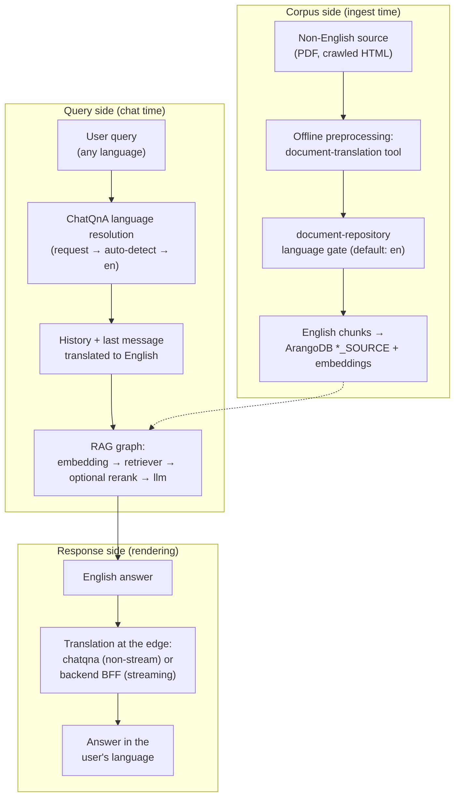

> **For contributors and deployers.** This page documents the verified
> multilingual design of the RAG pipeline, audited on the El Salvador
> deployment in September 2026
> ([issue #1027](https://opensource.unicc.org/un/itu/genie-ai/-/issues/1027)).
> Read it before proposing any change to the retrieval language
> configuration — the "obvious" fixes (switching the BM25 analyzer, adding a
> translator node) break retrieval in ways that are hard to diagnose.

## The invariant

Every stage of the pipeline operates in English:

| Stage | Language | Enforced by |
|-------|----------|-------------|
| Corpus (documents on disk) | English source text | Operator preprocessing + ingest language gate |
| Chunks + embeddings (`*_SOURCE`) | English | The gate above; EN embedding model |
| Lexical index (`<GRAPH>_BM25_VIEW`) | English analyzer | `RETRIEVER_HYBRID_BM25_ANALYZER=text_en` |
| Query fed to the pipeline | English | ChatQnA translation of history + last message |
| LLM generation + system prompt | English | EN answer produced in the EN embedding space |
| Response shown to the user | User's language | Translation at the rendering edge (chatqna or backend BFF) |

No translator node exists inside the RAG graph. The megaservice graph built
by `_build_rag_graph` in
[`genie-ai-overlay/chatqna/genieai_chatqna.py`](https://opensource.unicc.org/un/itu/genie-ai/-/blob/main/genie-ai-overlay/chatqna/genieai_chatqna.py)
is strictly `embedding → retriever → [rerank] → llm`.

## Corpus side: English by construction

English corpus text is enforced for the standard text-bearing document types
(PDF, Word, Markdown, HTML, plain text). Two mechanisms provide it:

1. **Offline preprocessing.** The
   [`document-translation/`](https://opensource.unicc.org/un/itu/genie-ai/-/tree/main/document-translation)
   directory ships an operator-run utility (`genieai_pdf_translator.py`)
   that converts source PDFs to Markdown (Docling + OCR) and translates the
   Markdown to English, using the deployment's translation service
   (`vllm-translation-guardrail`) or a local Ollama model. **This tool is
   not part of the automated ingest path** — nothing in `docker-compose.yaml`,
   dataprep, or document-repository calls it. That answers the open question
   the audit left open: there is no ingest-time document translation
   microservice, and translating source documents is a deliberate,
   human-triggered step.
2. **The ingest language gate.** On upload,
   [`document-repository`](https://opensource.unicc.org/un/itu/genie-ai/-/tree/main/components/document-repository)
   extracts text from the file, detects the language (`langdetect.detectOne`)
   and **rejects the upload** when the detected language does not match
   `DOCUMENT_INGESTION_LANGUAGE` (default `en`). The gate runs for the
   ingestable text types listed above. File types outside that list (e.g.
   `.pptx`, `.xlsx`, AsciiDoc, which dataprep can still chunk) and OKF
   bundle uploads bypass the check, so their content language is whatever
   the operator put in them. The `files.language` field in ArangoDB stores
   the *detected content language* (null when detection was skipped) — an
   all-`en` listing is the expected result of the gate working, not evidence
   of an in-pipeline translator.

Dataprep then chunks the English documents and optionally prepends
LLM-generated English document-context prefixes (Contextual Retrieval —
see [Contextual retrieval]()),
so chunk text in `<GRAPH>_SOURCE` is English throughout.

## Query side: normalize to English, then retrieve

ChatQnA resolves the request language once per request:

1. **Explicit request language** — the frontend sends `context.language`
   from the UI locale.
2. **Auto-detection** — when absent, ChatQnA detects the language of the
   last user message (`langdetect`) and keeps it only if the shared language
   registry covers it.
3. **Fallback** — anything unresolved or unsupported defaults to `EN`.

The resolved language is never used for retrieval. `_get_translated_history_string`
translates the chat history (budget-capped) and the last user message to
**English** — the target is hardcoded (`HISTORY_TRANSLATION_TARGET = "en"`),
whatever language the caller asked for. Only the English text enters the
pipeline as the retrieval query, in the same language as the embeddings it
is compared against. See also
[Generation → Multilingual chat history](#multilingual-chat-history).

## Retrieval side: why `text_en` is correct

The BM25 lexical leg (opt-in hybrid retrieval) analyzes chunk text with
`RETRIEVER_HYBRID_BM25_ANALYZER` (default `text_en`), set on the ArangoSearch
view `<GRAPH>_BM25_VIEW` over `<GRAPH>_SOURCE.text`. The English analyzer is
correct **because the corpus is English by construction** — the gate and the
preprocessing above are what make it correct. Functional probes run during
the September 2026 audit on the El Salvador deployment (recorded in
[issue #1027](https://opensource.unicc.org/un/itu/genie-ai/-/issues/1027);
point-in-time observations, not a reproducible repo artifact) showed the
split: a Spanish query against the `text_en` view returned 5 corpus hits;
the same query against a `text_es` view returned 0. If the corpus or the
retrieval configuration changes, re-derive this against the live view
before trusting it.

Two operational facts make analyzer changes risky:

- **Changing the env var does not change an existing view.** `_ensure_bm25_view`
  creates the view only when it does not exist; an already-created view keeps
  the analyzer it was created with. Switching the env var alone is a silent
  no-op — the view must be deleted and recreated.
- **A non-English analyzer against the English corpus breaks the BM25 leg.**
  Stemming/stop-word rules for the wrong language do not match English
  morphology, and the lexical channel degrades to noise. This is the
  regression the audit flagged as likely: future contributors
  re-proposing "switch BM25 to `text_es`" for a Spanish deployment without
  noticing the corpus itself is English.

If a deployment genuinely serves a non-English corpus (i.e. the ingest gate
was deliberately reconfigured via `DOCUMENT_INGESTION_LANGUAGE`), the
analyzer may be changed **together with** the corpus language — both sides
must move, and the view must be recreated. Absent that explicit, verified
decision: leave `text_en` alone.

## Translation model and services

On a GPU-backed deployment (the production shape: a `gpu-models` profile or
a remote GPU API), all translation calls share one vLLM endpoint and one
model:

- **`vllm-translation-guardrail`** (compose, `gpu-models` profile) — a vLLM
  server on the GPU node at port 9031 serving `VLLM_TRANSLATION_MODEL_ID`
  (default `google/gemma-3-4b-it`; alternatives in
  [Generation → Translation](#translation)).
- **ChatQnA** posts to it directly (compose wires
  `TRANSLATION_SERVICE_HOST_IP=vllm-translation-guardrail`):
  - chat-template models get `/v1/chat/completions`; a TranslateGemma model
    gets the completions API (`/v1/completions`) with a pre-formatted
    structured prompt — one read of the resolved model id decides both
    payload and response parse.
  - The upstream OPEA `translation` microservice (`opea/translation:1.3`)
    exists in the compose file but the default chatqna wiring bypasses it:
    its payload reformatting breaks TranslateGemma's structured chat
    template. ChatQnA falls back to the OPEA proxy only when
    `VLLM_TRANSLATION_ENDPOINT` is unset **and** `TRANSLATION_SERVICE_*`
    points at the microservice.
- **The backend BFF** (`gpu-translate-backend.js`) targets the same vLLM
  in-cluster, and `VLLM_TRANSLATION_ENDPOINT` on a remote-GPU deployment.
- **The supported-language registry** (`language-registry.json`) — chatqna
  and the backend each carry their own copy, identical today (the backend's
  language maps are derived from it) but **synchronized by hand, with no CI
  parity check**: adding or renaming a language means updating both copies.
  In each component, a language the registry does not list is refused (the
  English answer is kept), never guessed.

Remote-GPU deployments set `VLLM_TRANSLATION_ENDPOINT` on both chatqna and
the backend; both then reach the same model through one address.

Without a configured GPU API — or with `TRANSLATION_BACKEND=cpu` — the
**backend BFF** translates locally with an in-process
`Xenova/nllb-200-distilled-600M` instead: a different model family, no vLLM
involved, and `VLLM_TRANSLATION_MODEL_ID` has no effect on it. ChatQnA has
no CPU fallback: its translation endpoint is whatever the
`TRANSLATION_SERVICE_*` / `VLLM_TRANSLATION_ENDPOINT` wiring points at. See
[Streaming translation → Configuration](#configuration)
for the backend selection matrix.

## Response side: translate at the edge

The LLM answers in English; translation back to the user's language happens
in one of two places, outside the RAG graph:

- **Non-streaming (chatqna).** `_finalize_llm_response` translates the final
  English answer to the resolved language, in chunks sized to the
  translation model's window. Its `translation_status` metadata distinguishes
  `ok` (translated), `refused` (the requested language was refused — English
  kept) and `failed` (translation error — English kept), so a caller can
  always tell an English answer that was *not* translated from a translated
  one. Wire contract:
  [API contracts]().
- **Streaming (backend BFF).** With `STREAMING_TRANSLATION_ENABLED=1`, the
  backend buffers the English stream and translates complete units
  (sentence/paragraph boundaries) while the answer is being generated, with
  markdown structure preserved by an AST-based translator. Full behaviour,
  failure handling and troubleshooting:
  [Streaming translation]().

The frontend translates **no chat answer client-side**. The only chat-
adjacent content it translates itself is the right-sidebar Quick Help /
service labels; all other UI chrome (menus, settings, admin pages) is
static vue-i18n content — a separate translation layer, unrelated to the
RAG pipeline. For chat answers in a non-English UI, the backend translation
paths above are the only mechanism.

## Cross-lingual embeddings are not a design dependency

The embedding model (`EMBEDDING_MODEL_ID`, default `BAAI/bge-large-en-v1.5`)
is English-trained. It happens to carry some cross-lingual signal — audit
probes (point-in-time) measured top-1 cosine gaps below 0.005 between
raw-Spanish and English queries — but the pipeline does not rely on
it: non-English retrieval quality comes from the explicit query translation,
not from incidental embedding multilingualism.

## Related

- [Architecture Overview](/docs/architecture/architecture/) — the C4
  container view and the full RAG pipeline flow.
- [OPEA Microservices](/docs/architecture/opea-microservices/) — the
  overlay services and their contract surface.
- [Streaming translation]() —
  the response-side streaming translator in depth.
- [Generation → Translation](#translation) —
  translation models, cost notes, and the non-streaming path.
- [Generation → Multilingual chat history](#multilingual-chat-history) —
  the history-to-English normalization on the query side.
- [Retrieval]() — the hybrid
  dense + BM25 configuration surface, including `RETRIEVER_HYBRID_BM25_ANALYZER`.
- [Ingestion and chunking]() —
  what dataprep stores in `<GRAPH>_SOURCE`.
