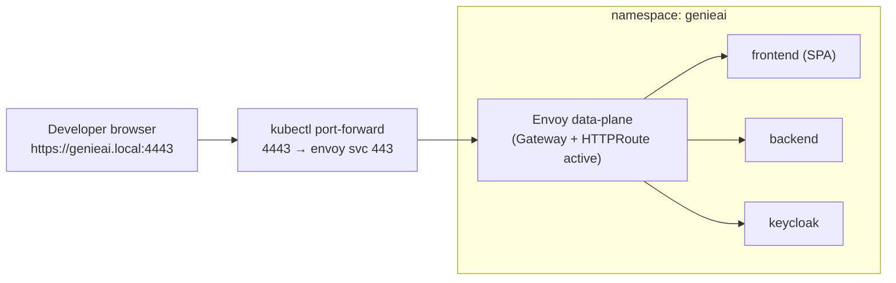
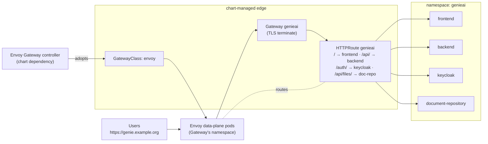
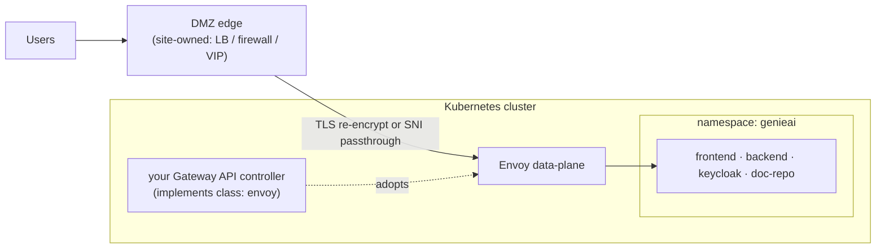

This guide covers GENIE.AI on Kubernetes via the `genieai-umbrella` Helm chart.
For single-host container deployments, see
[Docker Compose Setup](/docs/deploy/docker-compose-setup/); for multi-node
container orchestration, see [Docker Swarm Setup](/docs/deploy/docker-swarm-setup/).

## Overview

One chart, one release: `charts/genieai-umbrella` renders the full stack
(namespace, data tier, application tier, edge) from a single values file.
Environments diverge through overlays — a small per-env values file that
overrides `clusterProfile`, `ingress`, image tags, and Secret references.

GitOps is the supported distribution model. A companion `genie-ai-deploy`
repo holds the Flux `Kustomization` + `HelmRelease` for each environment.
Flux reconciles from the deploy repo at a fixed interval; the chart itself
lives under `charts/` in the application repo and is referenced by path.

## Prerequisites

**Cluster.**

- Kubernetes **1.33+**
- A default StorageClass that supports dynamic provisioning (used by the
  Arango, document-repository, Redis, and (in-cluster mode) model-cache PVCs)
- `kubectl` access to the target cluster from the operator workstation

**Cluster-scoped operators.** The chart renders custom resources, but it
does **not** install the operators that reconcile them. Each is a one-time
cluster bootstrap — installing them per-release causes competing
reconcilers and failed releases.

| Operator | Min version | Purpose |
|---|---|---|
| `kube-arangodb` | 1.4.x | ArangoDB `ArangoDeployment` / `ArangoMember` |
| CloudNativePG (`cnpg`) | ≥ 1.30 | The Keycloak Postgres cluster (`keycloak-db`) |
| `keycloak-operator` | 26.8.0 | `Keycloak` CR + realm import infrastructure |
| `cert-manager` | latest | Per-env TLS — required when issuer pinning is enabled |
| `sealed-secrets` (or alternative) | ≥ 0.40 | Encrypts Secrets into the deploy repo |

Later tiers add: GPU device plugin + node feature discovery (when
`opea.gpu.mode=in-cluster`). The Envoy Gateway is NOT a prerequisite — it
ships as a chart dependency (`envoyGateway.enabled`, default on); see
[Exposure topologies](#exposure-topologies).

**Node labels** (when running models in-cluster):

```bash
kubectl label node <gpu-node> gpu=true
```

**Air-gapped clusters.** Set `global.kubeletToolsMirror` to an internal URL;
the chart's pre-install and helm-test Pods `curl`-download `kubectl` and
`jq` from a default public mirror otherwise.

## Install paths

Two paths exist; both end at the same release. Pick by how secrets are
managed cluster-wide.

### Path A — plain `helm install`

Use when Secrets are managed out-of-band (manual `kubectl apply`, External
Secrets Operator, HashiCorp Vault Agent). Render and apply:

```bash
helm install genieai charts/genieai-umbrella/ \
  --create-namespace --namespace genieai \
  -f my-values.yaml
```

The chart creates the `genieai` namespace; pass `--create-namespace` so
helm propagates it before the pre-install hooks run.

### Path B — Flux deploy-repo overlay

Use for GitOps. Each environment lives under `genie-ai-deploy/overlays/<cluster>/<env>/`:

```
overlays/<cluster>/<env>/
├── kustomization.yaml            # resource list (incl. SealedSecrets)
├── gitrepository-chart.yaml      # Flux GitRepository for genie-ai repo
├── helmrelease.yaml              # HelmRelease → charts/genieai-umbrella
├── helmrelease-kube-arangodb.yaml # per-namespace ArangoDB operator HelmRelease
├── helmrepository-arango.yaml    # chart source for that operator
├── namespace-genieai.yaml        # the genieai Namespace
├── values.yaml                   # ConfigMap values (cluster-shared, public)
├── secrets.template.yaml         # plaintext source for SOPS encryption (committed)
├── secrets.sops.yaml             # encrypted output (committed; decrypts via Flux SOPS integration when configured)
└── secrets/                      # SealedSecret materializations
    ├── arango-root-secret.yaml
    ├── keycloak-admin-credentials.yaml
    └── ...
```

The `HelmRelease` references two values sources — a `ConfigMap` of
operator-owned values, and a `Secret` of SOPS-decrypted values — and
materializes them via `valuesFrom`. Inline `values:` carries only the
per-pays overrides. The Application Secrets consumed by the chart (the
table above) are materialized in the `genieai` namespace as regular
Secrets by the SealedSecret controller (one `SealedSecret` per Secret,
committed in the overlay's `secrets/` directory) and mounted by the
chart's pods directly — they do not flow through `valuesFrom`.

per-overlay deltas:

```yaml
valuesFrom:
  - name: genieai-public        # ConfigMap
    kind: ConfigMap
  - name: genieai-secrets       # operator-override Secret (SOPS path;
    kind: Secret                # encrypted-only until the Flux SOPS
                                # decryption provider is installed)
values:
  data:
    keycloak:
      failOnPlaceholderSecrets: false
```

Set `spec.install.timeout` and `spec.upgrade.timeout` to **900s** — the
Keycloak convergence hook (kcc) and operator CRD reconciliation can each
exceed the helm-controller 5-minute default on cold clusters.

## Required Secrets

The chart references these Secrets by name; it never materializes them.
Bring them into the `genieai` namespace with your secret backend before
the release completes.

| Secret | Keys | Consumed by |
|---|---|---|
| `arango-root-secret` | `password` | `ARANGO_PASSWORD` (wired via `secretKeyRef`); root user setup |
| `vllm-api-key` | `VLLM_API_KEY`, `HF_TOKEN` | Backend translation endpoint; OPEA tier (HF_TOKEN gates `google/gemma-3-4b-it` and other gated models) |
| `keycloak-admin-credentials` | `username`, `password` | `Keycloak` CR `bootstrapAdmin.userSecret`; master realm convergence |
| `keycloak-db-credentials` | `username`, `password` | CNPG cluster; Keycloak `spec.db` |
| `keycloak-convergence-credentials` | `GENIE_ADMIN_PASSWORD`, `EMAIL_PASSWORD` | kcc convergence Job (`$(env:VAR)` placeholders in the realm body) |
| `keycloak-proxy-client-secret` | `KEYCLOAK_PROXY_CLIENT_SECRET` | Backend env (`genie-proxy-client` service account) |
| `kc-dataprep-client-secret` | `KC_DATAPREP_CLIENT_SECRET` | Dataprep client-credentials grant |
| `kc-grafana-client-secret` | `KC_GRAFANA_CLIENT_SECRET` | Grafana OIDC client |
| `email-password` | `password` | SMTP — required only when `data.keycloak.verifyEmail=true` |
| `translation-cache-password` | `password` | Backend translation cache |

Additional Secrets used in the SealedSecret pattern: `keycloak-db-credentials`,
`arango-jwt-secret`. A `kc-grafana-client-secret` is required when Grafana
SSO is enabled (planned Observability tier).

Setting `data.keycloak.convergence.enabled=false` skips the kcc hook and
the realm is never imported — useful for smoke installs.

## Configuration highlights

**`clusterProfile`** — drives replica counts and (where implemented) data-tier
topology. Valid values: `dev`, `staging`, `prod`. `sovereign` is reserved
until that profile lands. Per-service overrides go through
`clusterProfileReplicas` in your overlay.

**`ingress.host` and `ingress.scheme`** — public origin, **required** (no
chart default: the render fails with a supply-it message when unset).
`host` may carry a port (`genieai.local:4443`) — the port is kept for the
OIDC issuer and redirect URLs, and stripped where Kubernetes expects a
bare hostname (HTTPRoute hostnames, TLS `dnsNames`). `scheme` feeds
`KC_PUBLIC_ORIGIN` (realm `redirectUris`/`webOrigins`). See
[Exposure topologies](#exposure-topologies) below for the full matrix.

**`opea.enabled`** and **`opea.gpu.mode`** — enable the six OPEA
orchestrators (chatqna, retriever, dataprep, reranker, embedding,
translation) and pick the model-source world:

| Mode | Models run where | Endpoint layout |
|---|---|---|
| `external` | A standalone GPU node reachable by HTTPS (e.g. `https://10.0.0.110:444`) | `opea.gpu.nodeHost` + `opea.gpu.paths.{llm,embedding,reranker,translation,docling}` — orchestrators point at the URL the operator defines |
| `in-cluster` | Pods on `gpu=true` nodes; weights on a ReadWriteOnce PVC | `models.{llm,reranker}.modelId` + `models.cache` PVC; orchestrators reach models by in-cluster Service name |

Both modes rely on the `vllm-api-key` Secret.

**`services.backend.translation.streamingEnabled`** — stream the
target-language chat translation during generation (issue #829). Default
`true`. Set `false` only when the target LLM-translation backend cannot
keep up with the chat stream.

**`services.backend.translation.endpoint`** — set to the GPU-node
translation API to skip the in-process CPU model (which burns a CPU core
per dashboard render).

**`pluggable.storageClassName`** — overrides the cluster default StorageClass
for chart-managed PVCs. Empty string = use the cluster default.

## Exposure topologies

The chart ships an Envoy Gateway as an optional dependency
(`envoyGateway.enabled`, default `true`) and renders Gateway API
resources (`Gateway`, `GatewayClass`, `HTTPRoute`, optional
cert-manager `Certificate` and CORS `SecurityPolicy`). **There is no nginx
in the Kubernetes data path** — Envoy routes every public path (`/` SPA,
`/api/`, `/api-docs/`, `/auth/` Keycloak, `/api/files/` + `/uploads/`
document repository). Pick one of three scenarios:

### Scenario 1 — Edge deployed, port-forward as the local front (laptop/dev)

The full edge tier is deployed exactly as in Scenario 2 (Gateway API
resources rendered, Envoy routes everything), but there is no LoadBalancer
or DNS — a `kubectl port-forward` fronts the Envoy data-plane Service as
the stand-in. Use a **non-privileged local port** carried in
`ingress.host` (e.g. `genieai.local:4443`) so the browser origin matches
the OIDC issuer without root.



| Knob | Value |
|---|---|
| `ingress.enabled` | `true` |
| `envoyGateway.enabled` | `true` |
| `ingress.host` | `genieai.local:4443` (port-bearing, `https://` scheme) |

> `ingress.enabled: false` renders no Gateway/HTTPRoute at all — Envoy has
> nothing to route and any port-forward to it 404s. With the edge off, the
> NetworkPolicies also become ingress default-deny for the SPA: that mode
> assumes a CNI that does not enforce NetworkPolicy (minikube kubenet).
> Real clusters should run one of the scenarios above.

### Scenario 2 — Envoy Gateway in-chart (default)

`ingress.enabled: true` + `envoyGateway.enabled: true` (default). The chart
installs Envoy Gateway, owns the `GatewayClass`, terminates TLS
(cert-manager `Certificate` from `ingress.tls.issuerName`, or a pre-baked
Secret via `ingress.tls.secretName`), and NetworkPolicies only admit the
Envoy data-plane pods as external peers.



| Knob | Value |
|---|---|
| `ingress.enabled` | `true` |
| `envoyGateway.enabled` | `true` (default) |
| `ingress.tls.enabled` / `issuerName` / `secretName` | cert-manager flow (`issuerKind`: `ClusterIssuer` by default, set `Issuer` for a namespace-scoped one) or pre-baked certificate |
| `ingress.cors.allowOrigins` | optional CORS `SecurityPolicy` (empty = same-origin, no policy rendered) |

Two operational notes on this scenario:

- The certificate SAN is always the **port-stripped** hostname; an external
  issuer workflow must align its identifiers with that form.
- `GatewayClass.spec.controllerName` is immutable — upgrading a cluster
  that still carries a GatewayClass created with an older chart's
  controller name requires a one-time `kubectl delete gatewayclass envoy`
  (the chart recreates it).

### Scenario 3 — External controller / off-cluster edge

`ingress.enabled: true` + `envoyGateway.enabled: false`. The chart still
renders the `Gateway`/`HTTPRoute` set; your own controller implements the
`envoy` class (`ingress.className`). Typical sovereign shape: a DMZ edge
outside the cluster fronts Envoy (TLS re-encrypt or SNI passthrough) while
Envoy stays the single in-cluster path router — one routing table, no
second aggregator to keep in sync.



| Knob | Value |
|---|---|
| `ingress.enabled` | `true` |
| `envoyGateway.enabled` | `false` |
| `ingress.className` | your controller's class (default `envoy`) |
| `ingress.dataplaneNamespace` | set when the data-plane runs outside the app namespace (NetworkPolicy peers) |

### In-cluster transport security

The chart deliberately ships **no application-level TLS inside the
cluster**: TLS terminates at the edge, and service-to-service traffic
(frontend → backend, backend → chatqna, JWTs included) rides the pod
network in the clear. Clusters that require wire encryption for that
traffic should enable it at the CNI (WireGuard encryption in Cilium or
Calico) at cluster bootstrap — that covers every pod, including same-node
veth traffic, without per-service certificates or a mesh.

## Access

**Dev port-forward** (Scenario 1 — the validated laptop loop):

```bash
kubectl -n genieai port-forward svc/envoy-genieai-genieai-<hash> 4443:443
# Browse https://genieai.local:4443  (self-signed certificate)
```

The overlay sets `ingress.host: genieai.local:4443` and `scheme: https`;
`/etc/hosts` maps `genieai.local` to `127.0.0.1`. The browser origin must
carry the same port as the OIDC issuer or login redirects mismatch.

**Exposed environments** (Scenarios 2–3): browse the `ingress.host`
origin directly; TLS is the edge's concern.

## Validation

**Helm tests** — two test pods verify namespace + data-tier wiring:

```bash
make test                                  # ct install + helm test against kind
helm test genieai -n genieai
```

Both test Pods need `kubectl`; the chart's init container downloads it
into a shared `emptyDir`.

**Service health** — through the edge:

```bash
curl -sk -H "Host: genieai.local" https://localhost:4443/api/health   # backend
```

**Full live set** (per release cycle): themed login page, Register link,
French streamed chat, document upload → scan → ingestion, and a RAG answer
citing the freshly ingested document.

**Flux reconciliation:**

```bash
flux get hr genieai -n flux-system
flux reconcile hr genieai -n flux-system
```

**Pre-install hook failures** — the chart runs a dependency-graph Job
before any regular resource lands. If a `services.*` entry references a
disabled data tier, the Job fails the install with a clear
`dependency not satisfied` message naming the missing component.

## Reference

- Chart source: `charts/genieai-umbrella/` (`values.yaml`, `README.md`)
- Chart shipped versions: `charts/genieai-umbrella/Chart.yaml`
- Migration status, plan map, and remaining phases:
  `docs/charts/migration-status.md`
- Deploy repo: `genie-ai-deploy/overlays/<cluster>/<env>/`
